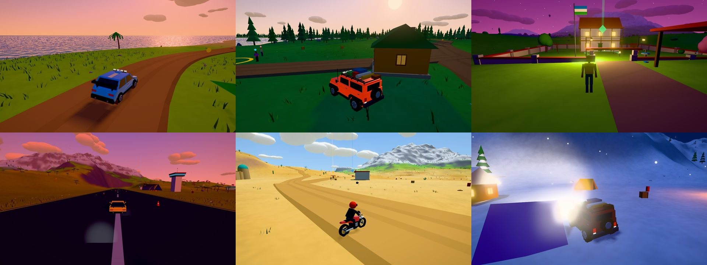
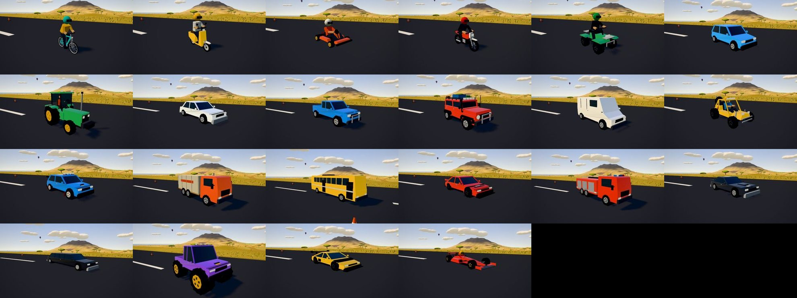
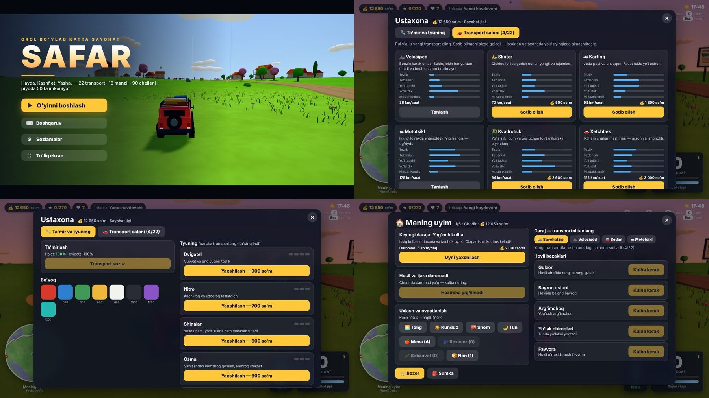
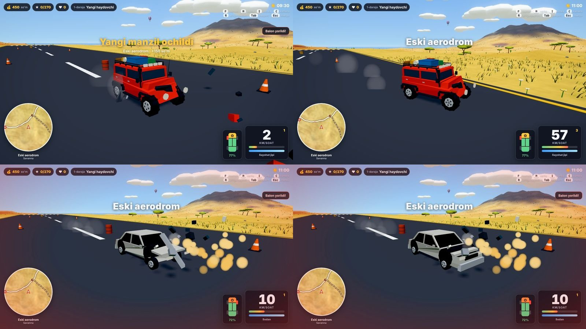
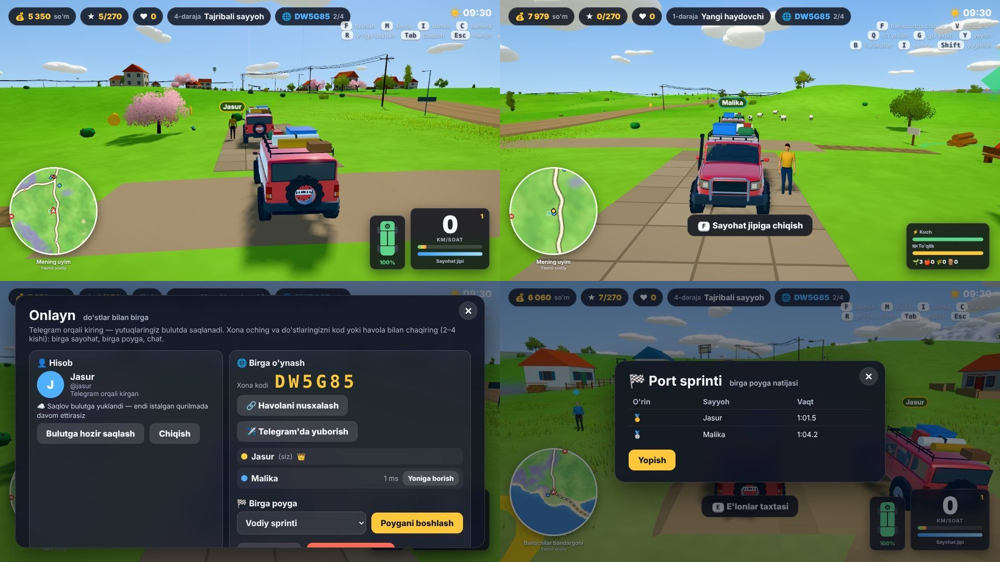

# SAFAR — orol bo'ylab katta sayohat

Brauzerda ochiladigan 3D sarguzasht o'yini: katta orol, 22 xil transport, 90 ta chellenj, mashinadan tushib piyoda yashash (50 ta imkoniyat), uy qurish, drift va haqiqiydek pachoqlanish. O'yin **bitta HTML fayl** — o'rnatish ham, internet ham kerak emas.



| | |
|---|---|
| Versiya | 2.0 (2026-11-13) |
| Til | o'zbekcha (lotin) |
| Texnologiya | Three.js r170 + esbuild. Barcha modellar, teksturalar, ovoz va musiqa kod ichida yaratiladi — tashqi fayl yuklanmaydi |
| Natija | `dist/SAFAR.html` (~1 MB) |
| Holat | v2 topshirilgan; ekransiz brauzerda sinalgan, haqiqiy kompyuterda egasi sinaydi ([cheklovlar](#10-tekshirilmagan-narsalar-va-malum-cheklovlar)) |

## Mundarija

1. [Tez boshlash](#1-tez-boshlash)
2. [O'yinda nima bor](#2-oyinda-nima-bor)
3. [Boshqaruv](#3-boshqaruv)
4. [Texnik tuzilish](#4-texnik-tuzilish)
5. [Sinov](#5-sinov)
6. [Vercel'ga joylash](#6-vercelga-joylash)
7. [Loyiha qoidalari](#7-loyiha-qoidalari)
8. [Tarix](#8-tarix)
9. [Tuzatilgan muhim xatolar](#9-tuzatilgan-muhim-xatolar)
10. [Tekshirilmagan narsalar va ma'lum cheklovlar](#10-tekshirilmagan-narsalar-va-malum-cheklovlar)
11. [Keyingi g'oyalar](#11-keyingi-goyalar)
12. [Uchinchi tomon kutubxonalari](#12-uchinchi-tomon-kutubxonalari)
13. [Onlayn rejim](#13-onlayn-rejim)

---

## 1. Tez boshlash

Node.js 20 yoki undan yangisi kerak.

```bash
npm install        # bir marta
npm run build      # dist/SAFAR.html, dist/vercel/ va dist/SAFAR-vercel.zip
npm test           # fizika sinovlari (3–4 soniya)
```

- **O'ynash:** `dist/SAFAR.html` ni ikki marta bosing — brauzerda ochiladi.
- **Tez yig'ish (siqilmagan kod):** `npm run build:dev`.
- **Internetga joylash:** [6-bo'lim](#6-vercelga-joylash).

`dist/` va `shots/` git'ga kirmaydi (`.gitignore`) — ular har safar qayta yaratiladi.

---

## 2. O'yinda nima bor

### 2.1. Dunyo

6,4 × 6,4 km xarita, 25,4 km² quruqlik, eng baland cho'qqi 518 m. 10 xil hudud (yashil vodiy, oltin o'rmon, tayga, cho'l, qizil dara, qorli tog', sohil, sakura vodiysi, savanna, vulqon etagi), 34,7 km yo'l (21 tugun, 25 bo'lak), daryo, ko'llar, kecha-kunduz almashinuvi (bir sutka — 20 daqiqa). Orolda 32 nafar aholi, 21 ta qo'y, yo'llarda 8 ta boshqa mashina, 528 ta tanga va 32 ta sandiq bor.

| № | Manzil | Hudud | Nima bor |
|---|---|---|---|
| 1 | Bog'iston qishlog'i | Yashil vodiy | e'lonlar taxtasi, **ustaxona**, 5 chellenj |
| 2 | Mayoq burni | Yashil vodiy (sohil) | taxta, 4 chellenj |
| 3 | Baliqchilar bandargohi | Yashil vodiy (sohil) | taxta, **ustaxona**, 4 chellenj |
| 4 | Oltin o'rmon | Oltin o'rmon | taxta, **ustaxona**, 4 chellenj |
| 5 | Ko'zgu ko'l | Tayga | taxta, dam olish joyi, 5 chellenj |
| 6 | Qorli lager | Oqtog' qorlari | taxta, dam olish joyi, 5 chellenj |
| 7 | Cho'qqi rasadxonasi | Oqtog' qorlari | taxta, 4 chellenj |
| 8 | Karvonsaroy | Qizilqum cho'li | taxta, **ustaxona**, 4 chellenj |
| 9 | Qizil dara | Qizil dara | taxta, 4 chellenj |
| 10 | Eski aerodrom | Savanna | taxta, **ustaxona**, uchish yo'lagi, 6 chellenj |
| 11 | Ko'hna qal'a | Yashil vodiy | taxta, 4 chellenj |
| 12 | Tosh karyeri | Yashil vodiy | taxta, tryuk maydoni, 5 chellenj |
| 13 | Shamol tegirmonlari | Yashil vodiy | taxta, 1 chellenj |
| 14 | Olovtog' krateri | Olovtog' etagi | taxta, 1 chellenj |
| 15 | Muzko'l | Oqtog' qorlari | taxta, muz maydoni, 1 chellenj |
| 16 | Mening uyim | Yashil vodiy | o'yinchining uyi (yangi o'yin shu yerdan boshlanadi) |

Yo'llarda 482 ta olib tashlasa bo'ladigan tosh, 17 ta tramplin va 16 ta tezlik radari bor. Toshlar transportga haqiqiy to'siqdek ta'sir qiladi: jip yengil sakraydi, superkar va karting tagi bilan uriladi, monster-trak sezmaydi ham.

### 2.2. Transportlar (22 ta)

Yangi o'yinda **Sayohat jipi** va **Velosiped** bor; qolganlari ustaxonadagi salonda yig'ilgan pulga olinadi. Har bir transportning o'z fizikasi bor (massa, quvvat, yuritma, g'ildirak o'lchami). Nomlar va dizaynlar o'zimizniki — haqiqiy brendlar ishlatilmagan.



| Transport | Turi | Narxi (so'm) | Tezlik (km/soat) | Yuritma | Izoh |
|---|---|---:|---:|---|---|
| **Velosiped** | ikki g'ildirakli | 0 (boshlang'ich) | 36 | orqa | benzinsiz, hech qachon buzilmaydi |
| Skuter | ikki g'ildirakli | 500 | 70 | orqa | yengil va tejamkor |
| Karting | ochiq | 1 800 | 98 | orqa | juda past, faqat tekis yo'l uchun |
| Mototsikl | ikki g'ildirakli | 2 200 | 175 | orqa | qattiq urilsa haydovchi yiqiladi |
| Kvadrotsikl | ochiq | 2 600 | 94 | to'liq | yo'lsizlik, qum, qor |
| Xetchbek | yengil | 3 000 | 152 | old | arzon shahar mashinasi |
| Traktor | traktor | 4 000 | 47 | to'liq | sekin, har qanday loydan chiqadi |
| Sedan | yengil | 4 800 | 188 | orqa | uzoq yo'l uchun |
| Pikap | yengil | 5 500 | 158 | to'liq | baquvvat |
| **Sayohat jipi** | jip | 0 (boshlang'ich) | 121 | to'liq | yo'l ham, yo'lsizlik ham |
| Furgon | furgon | 6 000 | 140 | orqa | baland — burilishda ehtiyot |
| Bagi | ochiq | 7 500 | 152 | orqa | qum barxanlari uchun |
| Ralli mashinasi | yengil | 9 500 | 208 | to'liq | shag'al yo'llar uchun |
| Yuk mashinasi | yuk | 10 000 | 114 | orqa | og'ir, to'siqlarni payqamaydi |
| Avtobus | avtobus | 11 000 | 106 | orqa | o'n metrlik |
| Sport kupe | yengil | 13 000 | 248 | orqa | asfaltda tengsiz |
| O't o'chirish mashinasi | yuk | 14 000 | 127 | to'liq | sirenali (H) |
| Muskul-kar | yengil | 15 000 | 252 | orqa | drift uchun eng zo'ri |
| Limuzin | yengil | 16 000 | 192 | orqa | yetti metrlik |
| Monster-trak | yo'ltanlamas | 18 000 | 136 | to'liq | bir metrlik g'ildiraklar |
| Superkar | yengil | 28 000 | 325 | to'liq | toshlardan qo'rqadi |
| Poyga bolidi | ochiq | 35 000 | 345 | orqa | eng tez |

### 2.3. Chellenjlar (90 ta, 270 yulduz)

Har bir chellenj natijaga qarab 1–3 yulduz beradi.

| Turi | Soni | Nima qilinadi |
|---|---:|---|
| Yetkazib berish | 11 | yukni vaqtida manzilga eltish |
| Yig'ish | 11 | tarqalgan narsalarni terib chiqish (qochgan qo'ylar, chig'anoqlar…) |
| Taksi | 6 | yo'lovchini manziliga eltish |
| Mo'rt yuk | 7 | urilmasdan yetkazish |
| Ko'p manzilli | 1 | "Tezkor pochta" |
| Poyga | 15 | raqiblar bilan; eng kattasi — **KATTA SAFAR** (5 000 so'm va oltin bo'yoq) |
| Drift zonasi | 3 | Muz drifti, Asfalt drifti, Karyer drifti |
| Buzish zonasi | 3 | Buzg'unchi, Pichan bayrami, Konuslar ovi |
| Radar | 16 | belgilangan joydan iloji boricha tez o'tish |
| Tramplin | 17 | iloji boricha uzoq sakrash |

**Cheksiz ishlar.** Har bir e'lonlar taxtasida ♾ kartasi bor: tasodifiy manzilga yetkazish, taksi yoki mo'rt yuk — tugamaydi (Muzko'l, Cho'qqi va Olovtog' manzil sifatida chiqmaydi). Yo'l chetida qo'l ko'targan yo'lovchilar ham doim paydo bo'lib turadi. Pauza menyusida "Yangi o'yin" bor.

**Daraja** tajriba (XP) bilan o'sadi: Yangi haydovchi → Yo'lovchi → Sayyoh → Tajribali sayyoh → Yo'l ustasi → Ralli ustasi → Orol afsonasi.

### 2.4. Piyoda hayot — 50 ta imkoniyat

**F** bilan transportdan tushiladi. Qahramonning kuchi va to'qligi bor: yugursa charchaydi, ovqat yesa tiklanadi.

**Harakat**

1. Transportdan tushish va chiqish (F)
2. Yugurish va charchoq (Shift)
3. Sakrash (Probel)
4. Suzish
5. Transportni hushtak bilan chaqirish (V)
6. Fonar — kechasi (L)
7. Durbin (Z)
8. Raqs (1)
9. Dutor chalish — odamlar pul tashlaydi (2)
10. Salomlashish (3)

**Tabiat**

11. O't yulish — pichan va ba'zan urug' chiqadi (Q)
12. Gul ekish (G)
13. Daraxtni silkitish — meva tushadi (E)
14. Meva yeyish (Y)
15. Butadan rezavor terish
16. Qo'ziqorin terish
17. Chig'anoq terish (sohilda)
18. Kapalak tutish
19. Yovvoyi gul terish (guldasta uchun)
20. O'tin yig'ish
21. Ko'chat ekish — vaqt o'tib mevali daraxt bo'ladi
22. Baliq ovi (qarmoq bilan, mini-o'yin)
23. Xazina qazish (belkurak bilan, yaltiroq joydan)
24. Ruda qazish (cho'kich bilan)
25. Yo'ldagi toshni olib tashlash — savob

**Qurish**

26. Gulxan yoqish (3 ta o'tin)
27. Gulxanda ovqat pishirish
28. Chodir tikish va tunash
29. Qorbobo yasash (qorda)
30. Qum qal'asi (qumda)
31. Bayroq tikish — cho'qqida mukofot bor

**Odamlar va yaxshilik**

32. Aholi bilan gaplashish
33. Och odamni ovqatlantirish
34. Guldasta sovg'a qilish
35. Yo'qolgan buyumni topib berish
36. Yo'lovchini manziliga eltish (cheksiz)
37. Axlat yig'ishtirish
38. Qo'ylarni pichan bilan boqish
39. Kuchukni erkalash

**Uy**

40. Uyni 5 darajagacha yaxshilash
41. Uxlash (vaqtni o'tkazish, kuchni tiklash)
42. Poliz — 6 ta jo'yak, sug'orish, hosil
43. Tovuq katagi — tuxum
44. Pochta qutisi — sovg'a
45. Hovli bezaklari
46. Garaj — uyda transport almashtirish

**Umumiy**

47. Yorilgan balonni almashtirish
48. Dalada ta'mirlash (ta'mir to'plami bilan)
49. Bozor — sotish va sotib olish
50. Kundalik topshiriqlar va kolleksiya albomi (25 tur)

Yaxshi ishlar uchun pul va **savob** (❤) beriladi. Qolgan harakatlar **B** — harakatlar menyusida.

### 2.5. Uy



| Daraja | Narxi (so'm) | Daromad (so'm/daq) | Nima qo'shiladi |
|---|---:|---:|---|
| 1. Chodir | 0 | 0 | chodir va gulxan, uxlash |
| 2. Yog'och kulba | 2 000 | 6 | o'tinxona, kuchuk uyasi — Olapar keladi |
| 3. Hovli uy | 6 000 | 16 | to'siq, poliz, tovuq katagi, pochta qutisi |
| 4. Ikki qavatli uy | 15 000 | 40 | balkon, tosh devor, mashina ayvoni, chiroqlar |
| 5. Villa | 35 000 | 90 | hovuz, mehmonxona qanoti |

Bezaklar (kulbadan boshlab): Gulzor 500, Bayroq ustuni 400, Arg'imchoq 600, Yo'lak chiroqlari 800, Favvora 1 500.

### 2.6. Bozor va buyumlar

- **Tovarlar:** Urug' ×5 — 40, Ko'chat — 120, Non — 30, Ta'mir to'plami — 220.
- **Asboblar:** Qarmoq 250, Belkurak 300, Cho'kich 350, Chodir 400, Dutor 300.
- **Bosh kiyimlar:** Somon shlyapa 200, Kepka 250, Do'ppi 400, Oltin toj 5 000.
- **Sotiladigan narsalar (dona narxi):** Pichan 5, Rezavor 6, O'tin 8, Yovvoyi gul 12, Meva 15, Qo'ziqorin 22, Tuxum 25, Chig'anoq 28, Baliq 45, Sabzavot 48, Ruda 60, Katta baliq 130, Yoqut 500.

### 2.7. Shikast, ustaxona, tyuning



- Qattiq narsaga urilganda korpus **o'sha joyidan ezilib pachoqlanadi**, qismlar (bamper, kapot, eshik, oyna…) uzilib tushadi, balon yorilishi mumkin.
- Old tomondan urilish dvigatelga zarar beradi: quvvat kamayadi, dvigatel holati 46 % dan pastga tushsa motor vaqti-vaqti bilan o'chib qoladi, 0 % da transport yurmaydi — **T** bilan evakuator chaqiriladi.
- Shikast har bir transportda alohida saqlanadi. Velosiped buzilmaydi, lekin ikki g'ildirakli transportda qattiq urilsa haydovchi yiqiladi.
- **Ustaxona** (5 ta manzilda): ta'mir, bo'yoq (8 rang + sovrinli oltin), tyuning va transport saloni.
- **Tyuning** (barcha transportga ta'sir qiladi): Dvigatel (4 bosqich), Nitro (3), Shinalar (3), Osma (3), Zirh (3), Tormoz (2).

### 2.8. Mukofotlar

- **Sakrash:** 10 m dan uzun sakrash uchun 220 so'mgacha.
- **Drift:** qo'l tormozi (Probel) bilan sirpanish ochko yig'adi, 320 so'mgacha.
- **Yaxshi ishlar:** pul va savob.
- Yo'llarda tangalar va sandiqlar, har bir yangi manzil uchun mukofot.

### 2.9. Grafika va ovoz

- HDR post-ishlov: bloom, tone mapping, rang korreksiyasi, vinyetka, MSAA ×4 (eng yuqori sifatda).
- Suv sheyderi: chuqurlikka qarab rang, qirg'oq ko'pigi, osmon aksi, quyosh jilosi.
- Yer teksturasi shovqini, suzuvchi bulut soyalari, shamolda tebranadigan o't va daraxtlar, tungi faralar va chiroqlar, tunda yaltiroq qo'ng'izlar.
- 3 ta sifat pog'onasi (Sozlamalar): Past (tez), O'rta, Yuqori (eng chiroyli). O'yin kompyuter kuchiga qarab aniqlikni o'zi moslaydi ([4.8](#48-moslashuvchan-grafika)).
- Ovoz va musiqa to'liq WebAudio'da sintez qilinadi — tayyor (birovning) yozuvi yo'q.

### 2.10. "Kasb Egalari" reklamasi

Tramplinlarning orqa devorida va yo'l bo'yidagi 17 ta bilbordda **Kasb Egalari** platformasining reklamasi turadi (katak qog'oz uslubida, `@kasb.egalari`). Uch xil matn:

1. "Ijodkor kerakmi? … Xaritadan toping"
2. "KASB EGALARI — Ijodkorlar platformasi"
3. "Ijodkormisiz? … Cheklanmagan buyurtma"

Matnlar `src/ads.js` da. Logotip va sayt manzili hali qo'yilmagan.

### 2.11. Kundalik hayot (uy ichi, do'kon, yoqilg'i, choyxona, kiyim, sartarosh, ishlar, telefon)

| Imkoniyat | Qanday |
|---|---|
| **Uyga kirish** | piyoda uy eshigi oldida **E** → haqiqiy ichki makon (darajaga qarab: chodir → kulba 2 xona → hovli uy/ikki qavatli uy/villa — mehmonxona, yotoqxona, oshxona, hammom). Chiqish — eshik oldida **E**. Uy ichida kamera yaqinroq va devordan chiqmaydi |
| **Uxlash** | karavot yonida **E** → qahramon yotadi, ekran qorayadi, vaqt budilnikkacha (standart 06:30) o'tadi, kuch 100 %, o'yin saqlanadi |
| **O'tirish** | divan, stul, kursi (uyda) va qishloq skameykalari — **E**; turish — yana **E** yoki yurish |
| **Oshxona** | plita — **E**: baliq → qovurilgan baliq, katta baliq → kabob, 2 qo'ziqorin → sho'rva, 2 tuxum → quymoq, 2 meva → salat, 2 sabzavot → dimlama (qozon kavlanadi, bug' chiqadi). Stol yonidagi stulga o'tirib **E** — ovqatlanish (+kuch). Muzlatkich (kulbada salqin quti) — ovqat saqlanadi |
| **Suv va chanqoq** | 💧 Suv ko'rsatkichi (piyoda panel). Jo'mrak yoki suv idishi — **E** (stakan bilan ichadi), quduq, do'kon ichimliklari (**Y** — chanqagan bo'lsa avval ichimlik). Chanqoq 30 % dan pastda yugurish kuchi kamayadi |
| **Do'kon** | Bog'iston va Baliqchilar bandargohida (xaritada yashil nuqta): eshik — **E**, sotuvchi Hamid aka bilan peshtaxtada **E** — suv 10, sharbat 18, non 12, shirinlik 15, pista 12, yoqilg'i kanistri 120 so'm |
| **Yoqilg'i** | velosipeddan boshqa transportda benzin bor (spidometr ostida ⛽). Sarf masofa, gaz va massa bo'yicha (to'liq bak ~40 km). 4 ta shoxobcha asosiy yo'llarda (xaritada to'q sariq nuqta): nasos yonida to'xtab **E** — quyiladi, 2 so'm / 1 %. Bak bo'sh — mashina faqat sudraladi (~11 km/soat). Kanistr — transport yonida piyoda **E** (+35 %) |
| **NPC suhbati** | qishloq aholisi (oddiy suhbatdoshlar) yonida **E** — 2–4 qatorlik suhbat (keksa, bola, fermer, sayyoh, savdogar), har safar boshqa; maslahat va kichik topshiriq ishorasi |
| **Mayda narsalar** | chiroqni yoqish/o'chirish (kalit), televizor (yangiliklar, multfilm, ob-havo — ekran harakatlanadi), radio (kulbada), qo'l yuvish, dush, ko'zgu (bosh kiyimni almashtirish), ko'k choy damlash, gazeta (o'yin holatidan sarlavhalar), budilnik soatini tanlash, uy daftari (yaxshilash/garaj), signal **H** — yaqindagi aholi qo'l silkiydi |
| **Choyxona** | Bog'istonda (xaritada to'q sariq nuqta): ichkarida topchan va stollar. O'tirish — **E**, so'ng **E** — menyu: osh 45, somsa 18, lag'mon 38, non 6, ko'k choy 6, kompot 10 so'm. Ofitsiant Sobir aka patnisda stolga olib keladi, **E** — ovqatlanish/ichish (to'qlik, suv, kuch) |
| **Kiyim do'koni** | Bog'istonda (binafsha nuqta): ko'zgu oldida **E** — ko'ylak rangi (10), uslub (kalta/uzun yeng, jilet, milliy zarbof), shim (6), bosh kiyim (jun qalpoq, panama, shlyapa + bozordagilar). Tanlangan kiyim darhol egningizda (ko'zgu kamerasi), sotib olinmasa qaytadi. Sotib olinganlar saqlanadi, uydagi shkafda (**E**) almashtiriladi |
| **Sartaroshxona** | Bog'istonda (pushti nuqta): kresloga o'tirib **E** — soch turmagi (oddiy/kalta/taqir/qalin), soch rangi (5), soqol/mo'ylov. Akmal usta qaychi bilan ishlaydi, natija saqlanadi |
| **Ishlar** | ish beruvchi oldida **E** (sariq nuqta) yoki telefon → Ishlar. **Non yetkazish** (novvoy Karim aka): 5 uyga sariq nur — piyoda yoki mashinada **E**, 30 so'm/uy + tezlik bonusi, ~2,5 daqiqa. **Taksi smenasi** (dispetcher Lola opa): 3 yo'lovchi — ko'k belgi yonida to'xtab **E**, manzilga eltsangiz o'zi tushadi, masofa bo'yicha + o'z vaqtida +20, bonus 80. **Dalada o'rim** (fermer Bobur aka): o'roq bilan 6 bog' o'rib, yelkada aravaga tashish, 18 so'm/bog' + 70 bonus, ~3 daqiqa. **X** — ishni tugatish |
| **Telefon** | **4** (yoki yuqoridagi «Telefon» tugmasi): Xarita, Bank (balans va so'nggi pul harakatlari), Kontaktlar (taksi — transportingizni yoningizga 60 so'm; mexanik Rustam — joyida ta'mir; onam; dispetcher), Kamera (surat rejimi), Ob-havo va soat, Ishlar (yo'l ko'rsatish), Musiqa, Uyim |
| **Ko'cha** | muzqaymoqchi (8 so'm, **E**), kaptarlarga don sepish (to'planib keladi; yugursangiz uchib ketadi), futbol maydoni (to'pni yurib surasiz, **E** — tepish, gol — 15 so'm), avtobus bekati (o'tirib kutasiz, avtobus keladi — **E**, 15 so'mga istalgan manzilga), o'tayotgan mashinaga **3** bilan qo'l silkisangiz signal chaladi |
| **Hafta** | **6** (yoki yuqoridagi «Hafta» tugmasi, telefon → Hafta, pauza menyusi): har ISO haftada bitta chellenj (poyga, drift yoki sindirish — hafta raqamidan aniqlanadi, barcha do'stlarda bir xil, internetsiz ham). «Boshlash» start chizig'iga yoki o'sha manzilga olib boradi; hafta rekordi saqlanadi, mukofot ★ 300 / ★★ 600 / ★★★ 1000 so'm (farqi bir marta). Hafta ko'rsatkichlari: topilgan pul, bosilgan yo'l, bajarilgan ishlar, poyga g'alabalari; 8 ta nishon (Ilk qadam, Oltin hafta, Boyvachcha, Uzoq yo'l, Mehnatkash, Poyga ustasi, Hafta yulduzi, Doimiy sayyoh) — olinganda xabar chiqadi. Kirgan o'yinchida — hafta reytingi (chellenj va 4 ko'rsatkich, xonadagi do'stlar 👥 belgisi bilan). Bankda endi har bir pul harakati sababi bilan (chellenj, hafta mukofoti, tanga, sandiq, tyuning, bozor…) |

### 2.12. Ob-havo, tadbirlar va gavjum ko'chalar

**Ob-havo** o'zi almashadi, lekin kam: ochiq havo ustun (~63 % vaqt ochiq, ~24 % bulutli). Yomon havo (yomg'ir, momaqaldiroq, qishda qor) har faslda (3 o'yin kuni ≈ 1 soat) ko'pi bilan bir marta keladi va 9–15 o'yin soati (≈ 8–12 daqiqa) davom etadi; yomon havolar orasi o'rtacha ~1,5 soat real vaqt (kamida ~25 daqiqa). Undan oldin 3 soat bulut yig'iladi, keyin 2 soat bulutli bo'lib ochiladi; tuman ba'zi kunlari faqat tongda. Fasl va hudud hisobga olinadi: qorli tog'da yomg'ir o'rniga qor, cho'lda yog'in bo'lmaydi, qishda tayga ham qorli. Yog'in ~1 daqiqada asta kuchayadi, osmon undan oldin qoplanadi. Qoplangan osmon bir tekis kulrang (ko'k «teshik» qolmaydi), ochiq havodagi ko'rinish o'zgarmaydi. Tom, ayvon, soyabon, daraxt ostida va yopiq mashina ichida yog'in (va yerdagi tomchi halqalari) ko'rinmaydi.

| Holat | Nima bo'ladi |
|---|---|
| Yomg'ir / momaqaldiroq | tomchilar (GPU), osmon bulut bilan qoplanadi, yerga tushgan tomchi halqalari, yo'l asta namlanadi (to'qroq, yaltiroq, tekis joyda ko'lmaklarda osmon aksi), g'ildirak ortidan suv changi, yomg'ir shovqini; momaqaldiroqda chaqmoq chaqadi (yorug'lik kuchi bir lahza oshadi), masofaga qarab kechikib momaqaldiroq gumburlaydi. Kabinadan (kamera 2) qaraganda oyna tozalagichlari ishlaydi |
| Qor | qor parchalari shamolda tebranib tushadi, yer, tom va tepaga qaragan hamma sirt asta oqaradi (yo'l izlarida kamroq), piyoda qahramon og'zidan bug' chiqadi; qor yomg'irda tezroq eriydi |
| Tuman | ko'rinish ~250 m gacha tushadi, faralar o'zi yoqiladi |
| Tutish | nam yo'lda shinalar tutishi −20 %, qorda −36 % — tormoz yo'li uzayadi, burilishda sirpanadi (o'yinchiga ogohlantirish chiqadi) |

**Taqvim:** o'yin kuni (soat 24:00 dan o'tganda keyingisi), hafta kuni (Dushanba…Yakshanba) va 12 kunlik yil (Bahor, Yoz, Kuz, Qish — har biri 3 kun). Telefon → **Ob-havo** ilovasida hozirgi holat, yo'l sirpanchiqligi, 18 soatlik prognoz va yaqin tadbirlar ro'yxati bor.

**Tadbirlar (Bog'iston):**

| Tadbir | Qachon | Nima bor, nima qilsa bo'ladi |
|---|---|---|
| 💍 To'y | shanba (ba'zan payshanba), 14:00–23:00 | katta hovli bezatiladi: bayroqcha va chiroq shodalari, darvozada lentalar va «TO'YINGIZ MUBORAK!» yozuvi, dasturxon (lagan osh, non, meva), kelin-kuyov o'rni, karnay va doira chaluvchilar (musiqa sintez qilinadi), davra raqsi. O'rindiqda **E** — dasturxonga o'tirish, yana **E** — osh yeyish (to'qlik 100 %, kuniga bir marta ❤ +3). Davrada **1** (raqs) — 6 soniyadan keyin olqish (kuniga bir marta ❤ +2, 15 so'm). 12:00–15:00 qishloq yo'llarida lentali kortej (4 mashina, oq boshlovchi, sharlar) signal chalib aylanadi |
| 🧺 Bozor kuni | chorshanba va yakshanba, 07:00–15:00 | maydon atrofida 9 ta qo'shimcha rasta, xaridorlar olomoni, sotuvchilar chaqiradi (ustida yozuv + ovoz). Rasta oldida **E** — bozor oynasi |
| 🌷 Navro'z sayli | har yilning 1-kuni, 08:00–20:00 | qishloq chetidagi maydonda sumalak qozoni (bug' va olov), bezatilgan darvoza, bayroqlar, lolalar, dasturxon, arg'imchoqda bola, raqs davrasi va musiqa. Qozon oldida **E** — sumalak kavlash (kuniga bir marta ❤ +3 va 20 so'm), stol oldida **E** — sumalak tatib ko'rish. Raqs — xuddi to'ydagidek |

Bugungi tadbir xaritada katta rangli nuqta bo'lib chiqadi, ertalab e'lon qilinadi.

**Gavjum ko'chalar:** Bog'iston markazidagi chorrahada svetofor (yashil → sariq → keyingi yo'l → hamma qizil: piyodalar o'tadi) va uchta zebra. Qishloq yo'llarida qo'shimcha 14 mashina (sifatga qarab 4/8/14) va 12 piyoda (4/8/12) bor: mashinalar egrilik va oldidagini hisobga olib yuradi, qizilda va o'tish joyida piyoda bo'lsa to'xtaydi (oddiy yo'l mashinalari ham), piyodalar trotuardan yurib, piyoda fazasida zebradan o'tadi. Qishloqdan 1,1 km uzoqlashsangiz hammasi to'xtatiladi.

### 2.12. Kundalik hayot 3 (biznes, uy kengaytmalari, charchoq va kun rejasi, qishloq topshiriqlari)

| Imkoniyat | Qanday |
|---|---|
| **O'z biznesingiz** | Bog'iston do'koni (12 000), kiyim do'koni (16 000) yoki choyxona (22 000 so'm): ichkarida peshtaxta yonida **E** → «sotib olish». So'ng o'yin vaqti o'tishi bilan (uxlaganda ham) savdo kassaga yig'iladi: kun vaqtiga qarab mijozlar oqimi o'zgaradi (choyxona — tushlik va kechqurun gavjum). **Boshqaruv** (o'sha joyda **E** yoki telefon → 🏪 Biznesim): kassani olish (faqat biznesda) yoki «avto-bank» (har soatda bankka, 5 % komissiya), tovar keltirish (tovar tugasa savdo deyarli to'xtaydi), ishchi yollash (3 tagacha, har biri +35 %, soatbay maosh), daraja 1→5 (savdo ×3,6, tashqarida yangi bezaklar: «★ Sizniki» belgisi, gul tuvaklar, skameyka, soyabonli stol, rangli chiroqlar), reklama (12 soat +40 %). Biznes oldida mijozlar yurib kirib-chiqadi va o'tiradi — daraja oshgani sari ko'payadi; choyxona ichida qo'shimcha mehmonlar va yollangan ishchi ko'rinadi. Har bir pul harakati telefon bankida («Biznes: …») va biznes daftarida |
| **Uy kengaytmalari** | Uy daftari (**E** uyda stol yonida yoki uy oldida) → «🏗 Uy kengaytmalari»: **mehmon xonasi** (4 500, kulbadan: ikkinchi karavot — unda ham uxlasa bo'ladi, shkaf, gilam), **oshxonani yangilash** (3 500, hovli uydan: duxovka — uy somsasi, mevali pirog; samovar — choy tetiklashtiradi), **garaj** (6 000, uy yonida: transportni almashtirsangiz hozirgisi garajda turadi va 4 o'yin soatida o'zi ta'mirlanadi; ta'mir — mexanikdan 2 marta arzon, bak to'ldirish 1,5 so'm/%) |
| **Hovli jihozlari** | Katta topchan (o'tirsangiz tetiklik tiklanadi), uzum ishkomi (har 12 soatda +4 uzum), mangal (20 so'mga shashlik ×2), tandir (har 16 soatda 3 non; hovli uyda o'zi bor), mevali bog' (olma, o'rik, anor — har 12 soatda +6 meva, pishganda daraxtda ko'rinadi), girlyanda (kechqurun rang-barang yonadi). Pishgan taomlar (somsa, pirog, shashlik) **Y** bilan yeyiladi |
| **Tetiklik (charchoq)** | Piyoda panelda 😴 Tetiklik: uyg'oq vaqtda asta kamayadi (~20 o'yin soatida), yugursangiz tezroq, o'tirsangiz biroz tiklanadi, choy ichsangiz +6 (samovar +20). 25 % dan past: biroz sekin yuriladi, ekran chetlari qorayadi va ba'zan ko'z yumiladi, esnash eslatmalari, transportda rul biroz kechikib javob beradi (faqat kiritish — fizika o'zgarmaydi). Karavotda uxlasangiz (yoki chodirda dam olsangiz) — 100 % |
| **Ish jadvali va kun rejasi** | Non yetkazish 06:00–11:00, taksi 07:00–22:00, dala 08:00–18:00 — vaqtida boshlasangiz to'lov +30 % («Ish vaqti bonusi»), boshqa vaqtda ham ishlash mumkin (bonussiz). Telefon → 📅 Bugungi reja (yoki **7**): tetiklik, hurmat, ishlar (hozir vaqtimi), tushlik, biznes eslatmalari (tovar kam, kassa to'lyapti), topshiriqlar, uyqu vaqti; qatorni bossangiz — xaritada yo'l |
| **Qishloq topshiriqlari** | Ustida sariq «!» belgisi bor aholi bilan **E** — iltimos (10 xil): kampirning sumkasini uyiga olib borish, boshqa qishloqqa xat yetkazish, qochgan echkini topib yetaklab kelish (ortingizdan ergashadi), uchta tovuqni ushlash, quduqdan chelakda suv olib kelish, shamol yiqitgan to'siqni tuzatish, mashinada bozorga olib borish, ikkita non, to'rtta o'tin yoki bitta baliq olib kelish. Nishon — yashil nur va GPS (echki va tovuqlar ustida yaqindan yashil ko'rsatkich), tepada topshiriq paneli, **X** — voz kechish; boshlangan topshiriq saqlanadi va o'yin qayta ochilganda davom etadi. Mukofot: pul va 🤝 **hurmat**; har 10 hurmatda sovg'a va unvon (Yaxshi qo'shni → Hurmatli inson → Mahallaning g'ururi → Oqsoqol) |
| **Haydovchi ko'rinishi** | Velosiped, skuter, mototsikl va boshqa ochiq transportda haydovchi endi qahramonning kiyimi, sochi, soqoli (dubulg'a bo'lmasa — shapkasi) bilan; kiyim almashsa darhol qayta quriladi. Onlayn do'stlar ham sizning kiyim-sochingizni ko'radi (holat paketida ixcham ko'rinish kodi) |


### 2.13. Suv va havo: qayiqlar va deltaplan

| Imkoniyat | Qanday |
|---|---|
| **Eshkakli qayiq** | Baliqchilar bandargohi va Ko'zgu ko'l iskalasi yonida turadi (xaritada feruza nuqta). Yoniga borib **E** — ijara 60 so'm (qayiq iskalaga qaytguncha qayta o'tirish bepul). **W/S** — eshkak (oldinga/orqaga, ~12 km/soat), **A/D** — burilish (joyida ham). Eshkaklar va eshkakchi harakatlanadi, qayiq to'lqinda chayqaladi; sayozlashgan sari sekinlashib qirg'oqqa yumshoq tiraladi, quruqlikka chiqmaydi, iskala va bezak qayiqlardan o'tmaydi. **F** — tushish: yaqin qirg'oq yoki iskalaga, bo'lmasa suvga. Qarmoq bo'lsa, to'xtab turganda **E** — baliq ovi (chuqur suvda katta baliq ko'proq). 350 m uzoqlashsangiz qayiq iskalaga qaytadi |
| **Yelkanli qayiq** | Bandargohda, ijara 200 so'm. Motor yo'q — shamol: **W** — yelkanni tortish, **S** — bo'shatish (sekinlash), **A/D** — rul. Tepada shamol o'qi (ekranga nisbatan qayerga esayotgani), tezlik va yelkan foizi. Yon shamolda eng tez (~30 km/soat), orqa shamolda sekinroq, shamolga qarshi (≈30° ichida) yurmaydi — ilon izi bilan boriladi: tezlikda burilsangiz qayiq shamol chizig'idan o'tib, ikkinchi bortga chiqadi. Yelkan va gik shamolga qarab buriladi, qayiq shamoldan og'adi |
| **Deltaplan** | Cho'qqi rasadxonasi maydonida ijara joyi (xaritada binafsha nuqta), **E** — 150 so'm: qoya chetidagi supadan uchasiz. **W** — tumshuqni pasaytirish (tezlik balandlik hisobiga), **S** — ko'tarish (sekinlash; juda sekinlasa qulab tezlashadi), **A/D** — burilish. Sekin cho'kadi (~7:1), shamol urilgan qiyaliklar va cho'l/dara/Olovtog' ustidagi issiq havo ko'taradi. HUD — yerdan balandlik, ko'tarilish/cho'kish, tezlik. Yerga tekkanda o'zi qo'nadi: har 100 m (to'g'ri chiziq) uchun 10 so'm (300 gacha), yumshoq qo'nishga +50; qattiq qo'nish — faqat yiqilib turasiz. Suvga ham qo'nsa bo'ladi. Havoda **F** ishlamaydi |

---

## 3. Boshqaruv


| Transportda | |
|---|---|
| W / S | gaz / tormoz va orqaga |
| A / D | burilish |
| Probel | qo'l tormozi — drift |
| Shift | nitro |
| F | transportdan tushish |
| R | yo'lga qaytarish |
| H / L | signal / faralar |
| T | evakuator (motor o'chganda) |
| E | e'lonlar taxtasi / ustaxona / yo'lovchi olish |

| Piyoda | |
|---|---|
| W A S D | yurish |
| Shift | yugurish |
| Probel | sakrash |
| F | transportga chiqish |
| V | transportni chaqirish |
| E | harakat (silkitish, gaplashish, terish…) |
| Q / G / Y | o't yulish / gul ekish / yeyish |
| B | harakatlar menyusi |
| 1 / 2 / 3 | raqs / dutor / salom |
| 4 | telefon |
| 6 | hafta: haftalik chellenj, reyting, nishonlar |
| 7 | telefon — bugungi reja |
| L / Z | fonar / durbin |

| Umumiy | |
|---|---|
| M | xarita va GPS |
| I | sumka, topshiriqlar, albom |
| Tab | sayohat pasporti |
| C | kamera (sichqoncha bilan aylantirish) |
| X | chellenjni yoki ishni bekor qilish |
| N | musiqa |
| O / U | onlayn oynasi / chat (xonada) |
| 5 / 8 | onlayn xonada: ovozli chat / do'stlarga «Shu yerga kel» belgisi |
| P | surat rejimi — interfeysni yashiradi (ekranda eslatma turadi, 20 soniyada o'zi qaytadi) |
| Esc | pauza |

**Ekrandagi tugmalar.** Pastki markazda hozir mumkin bo'lgan amallar tugma bo'lib turadi (klavisha nomi + amal: `[Q] O't yulish`, `[Shift] Nitro`…), uning ustida — yaqindagi narsaga mos katta tugma (`[E] Hosilni yig'ish`, `[E] Gulni olib tashlash`). Yuqori o'ngda umumiy tugmalar: xarita, sumka, pasport, kamera, surat rejimi, menyu. Tugmani bosish klavishani bosish bilan aynan bir xil: ikkalasi ham `controls.js` dagi bitta jadvaldan olinadi.

O'zi ekkan gul yonida **E** — gulni olib tashlash (urug' qaytadi, ekishda berilgan 10 so'm qaytariladi); hali o'sayotgan ko'chat yonida — qazib olish (ko'chat sumkaga qaytadi).

Geympad: RT/LT — gaz/tormoz, chap stik — rul, A — qo'l tormozi, X — nitro. Sensorli ekranda birinchi teginishda chapda virtual joystik (yurish, transportda rul va gaz/tormoz), o'ngda pedallar paydo bo'ladi; amallar — o'sha ekran tugmalari, mini-xarita chap tepaga ko'chadi. Telefonda yuqori o'ngdagi umumiy tugmalar 46×46 ikonka-plitkalar (Sumka, Pasport, Surat — pauza menyusi va telefonda); yotiq ekranda pedallar o'ng pastda, tikda — amal tugmalari yonida.

---

## 4. Texnik tuzilish

### 4.1. Papkalar

```
src/          o'yin kodi (ES modullar) + index.html + style.css
tools/        yig'ish va sinov skriptlari
assets/og.jpg havola ulashilganda ko'rinadigan rasm, 1200×630 (yig'ishda dist/vercel/ ga ko'chiriladi)
docs/img/     shu hujjatdagi rasmlar
vercel.json   Vercel sozlamalari (Git orqali joylash uchun)
dist/         yig'ish natijasi (git'da yo'q)
shots/        sinov skrinshotlari (git'da yo'q)
```

### 4.2. Fayl xaritasi (`src/`)

| Fayl | Vazifasi |
|---|---|
| `main.js` | kirish nuqtasi: dunyoni yig'ish tartibi, kadr sikli, klaviatura amallari, moslashuvchan grafika (`adapt`), sinov ilgaklari |
| `game.js` | o'yin holati va qoidalari: saqlash, pul/XP/daraja, chellenjlarni boshlash-tugatish, transport sotib olish va almashtirish, tyuning, sakrash/drift mukofotlari, evakuator, GPS |
| `acts.js` | 90 chellenj ta'rifi (`JOBS`, `RACES`, `ZONES`, `RADARS`), marshrut vaqtini baholash |
| `terrain.js` | orol: balandlik, hududlar, suv, yo'l tarmog'i va marshrut topish, manzillar (`PLACES`), yo'ldagi toshlar ("bump") |
| `worldgfx.js` | ko'rinadigan yer (LOD), yo'l lentalari, ko'priklar, suv |
| `places.js` | 15 manzil binolari, to'qnashuv jismlari, chiroqlar, tramplinlar |
| `home.js` | o'yinchining uyi: 5 daraja, bezaklar, poliz, katak, pochta qutisi |
| `interior.js` | ichki makonlar: uy (darajaga qarab xonalar) va do'kon — protsedura devor/mebel, pishirilgan yorug'lik (MeshBasic, yangi chiroq yo'q), kirish/chiqish, yopiq joy kamerasi, TV ekrani |
| `hayot.js` | kundalik hayot: chanqoq, uy ichidagi harakatlar, oshxona/muzlatkich/do'kon oynalari, NPC suhbati, do'kon binolari, HUD ko'rsatkichlari |
| `hayot2.js` | kundalik hayot 2: choyxona, kiyim do'koni, sartaroshxona (binolar va ichki makonlar `interior.js` qurollari — `IN.lib`, `IN.X` — bilan), ofitsiant, qahramon ko'rinishi (`restyle` — kiyim/soch o'zgarsa modelni qayta quradi) |
| `ish.js` | ishlar (non, taksi smenasi, dala), pul tarixi (`game.addMoney(n, sabab)`), telefon oynasi va xizmatlari |
| `hafta.js`, `haftalik.js` | haftalik chellenj, hafta statistikasi, nishonlar, «Hafta» oynasi; `haftalik.js` — sof hisob (hafta raqami, haftaning chellenji, chegaralar), server ham ishlatadi |
| `hayot3.js` | kundalik hayot 3 kirish nuqtasi; ikki g'ildirakli transport haydovchisini o'yinchi ko'rinishida qayta qurish |
| `kun.js` | o'yin soati hisobi (`game.kun.pass/on` — o'tgan vaqt tinglovchilarga), tetiklik va uning ta'siri, ish jadvali bonusi, telefon «Bugungi reja» |
| `biznes.js` | biznes: sotib olish, daromad (yarim soatlik bo'laklarda), kassa/avto-bank, tovar, ishchilar, daraja, reklama, tashqi bezaklar va mijozlar, telefon «Biznesim» |
| `uy2.js` | uy kengaytmalari: mehmon xonasi va oshxona (`interior.js` ilgaklari `IN.homeRooms/homeFurnish`), garaj, hovli jihozlari |
| `topshiriq.js` | qishloq topshiriqlari (10 tur), hurmat, «!» belgilari, topshiriq paneli |
| `suv.js` | suv va havo sayohati: qayiq va deltaplan ijarasi, o'tirish/tushish (o'yinchi piyoda, lekin o'rindiqqa qo'yiladi — coop.js yo'lovchisi kabi), kamera (`game.suv.cam`), HUD (shamol o'qi), xarita nuqtalari, qayiqdan baliq ovi |
| `qayiq.js` | eshkakli va yelkanli qayiq modeli va fizikasi (`boatStep`, `depthAt`, `sailEff`) — `physics.js` dan mustaqil |
| `deltaplan.js` | deltaplan modeli, uchish supasi va parvoz fizikasi (`glideStep`, `airLift`, `sinkAt`) |
| `kocha.js` | ko'cha: muzqaymoqchi, kaptarlar, futbol, avtobus bekati, mashinaga qo'l silkish |
| `fuel.js` | yoqilg'i: sarf, shoxobchalar (nasos, xodim), quyish, kanistr, gaz pedalini cheklash (`input.poll` ustida — `physics.js` o'zgarmagan) |
| `props.js` | daraxtlar, toshlar, butalar (InstancedMesh + LOD; uzoq variant 3×3 bo'lak guruhlarida bitta chizishga birlashadi), yaqin atrofdagi o't |
| `blocks.js` | qurilish bloklari: uy, devor, chodir, gulxan, o'rindiq, quduq, do'kon… |
| `geo.js` | low-poly geometriya quruvchisi (`GB`), materiallar (`MAT`), shamol (`WIND`) |
| `sky.js` | osmon, quyosh/oy, yulduzlar, bulutlar, yoritish va tuman |
| `gfx.js` | post-ishlov (bloom, rang, MSAA), suv sheyderi, osmon aksi (PMREM), sifat pog'onalari |
| `physics.js` | transport fizikasi (`Car`, `DEF_SPEC`), avtopilot (`Autopilot`) |
| `vehicles.js` | 22 transport: `VEHICLES` (narx, ta'rif, fizik `spec`) va protsedura modellari (`buildVehicle`) |
| `carmodel.js` | Sayohat jipining modeli, bo'yoqlar (`PAINTS`) |
| `damage.js` | shikast: zonalar, dvigatel, balonlar, korpus deformatsiyasi, qismlarning uzilishi |
| `player.js` | piyoda qahramon: yurish, yugurish, sakrash, suzish, to'qnashuv |
| `rig.js` | odam modeli va protsedura animatsiyalari, bosh kiyimlar, asboblar |
| `living.js` | "hayot" tizimlari: terimchilik, ekish, baliq ovi, aholi, yo'lovchilar, hayvonlar, uy xo'jaligi, qurish, topshiriqlar, albom, bozor |
| `life.js` | yo'ldagi boshqa mashinalar, qushlar, havo sharlari |
| `ads.js` | "Kasb Egalari" reklama taxtalari (CanvasTexture) |
| `obhavo.js` | ob-havo va taqvim: o'yin kuni, fasl, prognoz (fasl ichida ko'pi bilan bitta uzoq yomon havo — `spellOf`), yomg'ir/qor zarrachalari (bitta GPU chizish; tom ostida yashiriladi: kamera ustidan 64×64 «tepadan chuqurlik» xaritasi — mavjud materiallar bilan, sheyder kompilyatsiyasiz, ~0,7–2 marta/s; o'z mashinamiz — har kadr quti bilan), qoplangan osmon (`uOvc`), osmon/tuman/chaqmoq (`sky.setHour` ustidan), nam yo'l va qor qoplami (`uWet`, `uSnowC` uniformlari), yomg'ir va momaqaldiroq ovozi, tozalagich, tutish ko'paytuvchisi (`car.wetGrip`) |
| `tadbir.js` | tadbirlar: to'y (hovli bezagi, dasturxon, mehmonlar, musiqachilar, kelin-kuyov), bozor kuni (rastalar, olomon, chaqiriqlar), Navro'z (sumalak qozoni, arg'imchoq, raqs); rig hovuzi, sintez musiqa, **E** harakatlari, xarita va telefon |
| `shahar.js` | gavjum ko'cha: svetofor (`life.stopFor` ilgagi orqali yo'l mashinalari ham to'xtaydi), zebralar, qo'shimcha mashinalar (InstancedMesh), piyodalar, to'y korteji |
| `net.js`, `coop.js`, `onlineui.js` | onlayn rejim: kirish, bulutli saqlov, reyting; birga o'ynash xonasi; onlayn oynalar ([13](#13-onlayn-rejim)) |
| `camera.js` | kuzatuvchi kamera: transport, piyoda, durbin |
| `fx.js` | zarrachalar (chang, tutun, uchqun), parchalar, shina izlari |
| `audio.js` | sintez qilingan ovoz, dvigatel, generativ musiqa |
| `controls.js` | boshqaruv jadvali (`ACTIONS`): har bir klavisha nima qiladi, qachon ishlaydi va ekranda qanday tugma bo'lib chiqadi — klaviatura va ekran tugmalari uchun yagona manba |
| `input.js` | klaviatura, geympad, sensorli ekran | (+ virtual joystik qiymatlari `touch.jx/jy`)
| `ui.js` | HUD, mini-xarita, menyu va barcha oynalar (o'zbekcha) |
| `colliders.js` | statik to'qnashuv jismlari (doira, kesma, quti) |
| `util.js` | matematika, shovqin, tasodifiy sonlar, rang |
| `style.css`, `index.html` | interfeys uslubi va sahifa qolipi (`/*__CSS__*/`, `/*__JS__*/` o'rniga kod qo'yiladi) |

### 4.3. Ishga tushish tartibi va kadr sikli

`main.js` dunyoni shu tartibda yig'adi: `initWorld` → materiallar → osmon → yer → yo'llar → manzillar (uy bilan) → tabiat → transport, effektlar, kamera, kiritish, ovoz, shikast → `initGame` → piyoda qahramon → jonli dunyo → reklama → `initLiving` → `initGfx`.

Har kadrda: kiritish → fizika **1/120 s qat'iy qadam** bilan → o'yin mantig'i (`updateGame`, `live.update`) → kamera → render (`gfx.render`) → `adapt` (aniqlikni moslash).

### 4.4. Fizika va transport

`Car` — qattiq jism + raycast g'ildiraklar (prujina, amortizator), shina ishqalanishi, to'qnashuvlar. Har bir transport `spec` bilan sozlanadi:

`mass, len, wid, hgt, clr, com` (o'lchamlar va massa markazi) · `wx, wzF, wzR, rF, rR` (g'ildiraklar joyi va radiusi) · `free, travel, sag` (osma) · `power, top, a0, brake` (quvvat, eng yuqori tezlik, boshlang'ich tezlanish, tormoz) · `steer, drive ('awd'|'rwd'|'fwd'), grip, down`.

- Rul me'yorlashtirilgan: tezlik oshgani sari burilish burchagi kamayadi, qo'yib yuborilganda tez markazga qaytadi.
- Qo'l tormozi orqa g'ildiraklar tutishini kamaytiradi — drift.
- Ikki g'ildirakli transport tik turishi uchun yordamchi moment bor.

Model interfeysi (`buildVehicle(id)` qaytaradi): `{ id, v, spec, root, tilt, body, trimMesh, deform[], parts{nom: {mesh, zone, thr, on, home}}, paintMat, headMat, tailMat, wheels[{pivot, mesh, src, x, z, front, r}], rider, bike, … }`. G'ildiraklar `syncWheels(model, car, flatTires)` bilan yangilanadi.

### 4.5. Shikast

`damage.js`: zarba tezligi chegaradan (5,2 m/s; qo'nishda 7,5 m/s) oshsa zona sog'lig'i kamayadi, mesh uchlari mahalliy ezilish (`deform`) va yo'nalishli g'ijimlanish (`crush`) bilan siljiydi, qismlar chegaraga yetganda uziladi. `apply()` shikastni fizikaga o'tkazadi (quvvat, tutish, qarshilik, rul titrashi).

### 4.6. "Hayot" tizimlari

`living.js` (`game.live`): 16 m katakli tarmoq bo'yicha hududga mos narsalarni paydo qiladi (qo'ziqorin, chig'anoq, gul, o'tin, axlat, kapalak, rezavor, xazina, ruda), aholining rollari, 3 ta yo'lovchi, qo'ylar, kuchuk, tovuqlar, poliz, tuxum, pochta, baliq ovi, topshiriqlar, albom, savob. Yaqindagi narsaga mos harakatni `findCtx()` topadi — **E** shuni bajaradi.

### 4.7. Grafika

`gfx.js`: EffectComposer (HalfFloat, eng yuqori sifatda MSAA ×4) → UnrealBloom → rang korreksiyasi va vinyetka → OutputPass. Sifat pog'onasi: 0 — bloom va rangsiz, 1 — MSAA'siz, 2 — to'liq. Kompozitor bir marta quriladi; pog'ona almashganda faqat MSAA soni va o'tishlar yoqiladi/o'chiriladi. Sahna har doim nishonga chiziladi — ekranga to'g'ridan-to'g'ri chizish materiallarning sheyderini o'zgartirib, hammasini qayta kompilyatsiya qildirardi (o'yin 1–3 soniya qotib, ekran qora bo'lib qolardi). Yuklashda barcha sheyderlar (yashirin narsalarnikini ham) oldindan kompilyatsiya qilinadi; kanvas o'lchami o'zgarsa darhol qayta chiziladi; WebGL konteksti yo'qolsa qaytganda teksturalar qayta pishiriladi. Chiroqlar soni o'zgarmas saqlanadi (o'zgarsa sheyderlar qayta kompilyatsiya bo'lib, o'yin qotadi).

### 4.8. Moslashuvchan grafika

`main.js` → `adapt()` har 2,5 soniyada o'rtacha kadr vaqtini o'lchaydi:

1. Sekin (24 ms dan ko'p) — piksel zichligini kamaytiradi; ravon (20,5 ms dan kam) — asta-sekin qaytaradi. Bu 60 Gs ekranda ham ishlaydi.
2. Boshqa oynaga o'tib qaytgandagi uzilish sekinlik hisoblanmaydi.
3. Kamaytirish **foyda bermasa** (masalan, brauzer quvvat tejash rejimida kadrni 30 ga cheklagan) — hammasi joyiga qaytariladi, tasvir bekorga xiralashmaydi.
4. Aniqlik eng pastga tushib ham sekin bo'lsa — sifat pog'onasi sinov tariqasida bir pog'ona tushiriladi; 10 soniyada tezlashmasa qaytariladi, tezlashsa o'yinchiga xabar chiqadi.
5. Avtomatik tushirilgan sifat keyin 45 soniya bemalol ravon ishlasa — qayta ko'tarib ko'riladi.

### 4.9. Saqlash

`localStorage`, kalit `safar_save_v2`. Yuklashda saqlangan holat standart holat (`defState()` — `game.js`) ustiga qo'shiladi, shuning uchun **yangi maydon qo'shilganda eski saqlovlar buzilmaydi** — faqat `defState()` ga standart qiymat yozish kerak. v1 saqlovlari ham ochiladi.

Asosiy maydonlar: `money, xp, stars, best, up` (tyuning), `veh {own, cur, dmg, paint}`, `inv` (buyumlar), `tools, hats, hat, karma, sat, energy`, `home {lvl, decor, beds, wat, eggT, mailT, incT}`, `flowers, trees, flags, tasks, cnt, seen, peaks`, `thirst` (chanqoq), `fuel {transport: %}`, `fridge` (muzlatkich), `alarm` (budilnik soati), `look` (kiyim va soch; null — boshlang'ich), `clothes` (sotib olingan kiyimlar), `income` (so'nggi 30 pul harakati), `jobs` (ish hisobi), `biz` (bizneslar: daraja, ishchi, tovar, kassa, daftar), `home2` (kengaytmalar, hovli jihozlari, garajdagi transport, hosil vaqtlari), `tetik` (tetiklik), `hurmat`, `errands` (bajarilgan topshiriqlar), `errCur` (bajarilayotgan topshiriq: tur, beruvchi, bosqich — qayta yuklanganda davom etadi; tiklab bo'lmasa xabar chiqadi va beruvchi uni qayta taklif qiladi; null — yo'q), `soat` (o'tgan o'yin soatlari), `hafta {w, best, stars, paid, tries, s {money, km, jobs, wins}, hist, badges, done, weeks}` (haftalik chellenj va hafta ko'rsatkichlari, km — metrda), `suv {row, sail, glide, km, best, fish}` (qayiq ijaralari, parvozlar, suzilgan m, eng uzoq parvoz m, qayiqdan baliq), `dunyo {day, toy, nav, dtoy, dnav}` (o'yin kuni — taqvim va ob-havo shundan; tadbir sovg'asi olingan kunlar), `stats`, `set {vol, music, gfx, damage}`, `hour, pos, foot`.

Saqlov brauzerning o'zida turadi. Saytda Telegram orqali kirilsa, xuddi shu JSON bulutga ham yoziladi va boshqa qurilmada olinadi ([13](#13-onlayn-rejim)); `safar_save_v2` formati o'zgarmagan.

### 4.10. Sinov ilgaklari

O'yin `window.G` orqali ochiq. Sahifa yuklanishidan oldin `window.__TEST = true` qo'yilsa: menyu o'tkazib yuboriladi, kadr sikli to'xtaydi, kun vaqti muzlatiladi va o'yin qo'lda yuritiladi. Yuklanib bo'lgach `window.__ready === true`.

| Ilgak | Nima qiladi |
|---|---|
| `G.sim(soniya)` | o'yinni rendersiz oldinga yuritadi |
| `G.advance(soniya)` | yuritadi va bitta kadr chizadi |
| `G.teleport(x, z, yaw, soat)` | transport yoki qahramonni ko'chiradi |
| `G.drive([tugunlar], tezlik)`, `G.autoTo(x, z)`, `G.autoPts(nuqtalar)` | avtopilot |
| `G.runUntil(shart, maxSoniya)` | shart bajarilguncha yuritadi |
| `G.view(x, y, z, tx, ty, tz, soat)` | kamerani qo'yadi (skrinshot uchun) |
| `G._adapt(kadrVaqti, n)` | moslashuvchan grafikaga sun'iy kadr vaqtini beradi |
| `G.dunyo.set('yomgir' \| 'dovul' \| 'qor' \| 'tuman' \| 'bulut' \| 'ochiq' \| null)` | ob-havoni majburlash (null — tabiiy), darhol qo'llanadi; `G.dunyo.forecast()`, `G.car.wetGrip` |
| `G.suv` (`enter(o, bepul)`, `off()`, `auto = [W/S, A/D]`, `windSet(burchak, m/s)`, `land()`), `G.boat`, `G.sailboat`, `G.glider` | qayiq/deltaplan: o'tirish, qo'lda boshqarish, shamolni qotirish |
| `G.tadbir.set('toy' \| 'bozor' \| 'navruz' \| null)` | tadbirni vaqtdan qat'i nazar yoqish; `G.tadbir.upcoming()`, `G.shahar.convoy(true)` |

### 4.11. Qanday qo'shiladi

- **Yangi transport:** `vehicles.js` → `VEHICLES` ga yozuv (`id, name, price, hex, cls, desc, eng, spec`) va model uslubi; keyin `npm test` — barqarorlikni tekshiradi.
- **Yangi chellenj:** `acts.js` → `JOBS` / `RACES` / `ZONES`.
- **Yangi buyum yoki asbob:** `living.js` → `ITEMS`, `SHOP`, `TOOLS`; tabiatda paydo bo'lishi — `KIND` va `SPAWN`.
- **Yangi saqlanadigan maydon:** `game.js` → `defState()`.
- **Reklama matni:** `ads.js` → `adCanvas(variant)`.
- **Interfeys matni:** `ui.js` (hammasi o'zbekcha).

---

## 5. Sinov

| Buyruq | Nimani tekshiradi | Vaqt |
|---|---|---|
| `npm test` | 22 transport fizikasi (tinch holat, tezlanish, eng yuqori tezlik, tormoz, burilish, 4 daqiqalik tasodifiy haydash) va rulning qaytishi. Natija jadval bo'lib chiqadi: `top 121/121`, `bad0 flips0` | ~4 s |
| `npm run test:roads` | avtopilot barcha yo'llarni ikki tomonga va katta halqani haydab chiqadi (`OK` / `FAIL`) | ~7 s |
| `npm run test:smoke` | o'yin yuklanadi, 90 chellenj joyida, skrinshot | ~20 s |
| `npm run test:real` | haqiqiy klaviatura bilan: menyu → haydash → tushish → oynalar → qayta chiqish | ~1 daq |
| `npm run test:hud` | tezlik/holat paneli 10 xil oyna o'lchamida ko'rinadi, oynalardan keyin joyida, surat rejimi o'zi qaytadi | ~1,5 daq |
| `npm run test:adapt` | moslashuvchan grafikaning 15 ssenariysi (60/120 Gs, oyna almashtirish, kuchsiz videokarta, 30 kadrga cheklov…) | ~40 s |
| `npm run test:save` | v1 saqlovi ochiladi; yangi holat saqlanib, qayta yuklanadi | ~40 s |
| `npm run test:life` | kundalik hayot: uyga kirish, uxlash, o'tirish/turish, pishirish va stolda ovqatlanish, suv ichish, do'kon xaridi, yoqilg'i quyish, bo'sh bak, NPC suhbati | ~1 daq |
| `npm run test:life2` | kundalik hayot 2: choyxona buyurtmasi va ovqatlanish, kiyim sotib olish/qaytishi va saqlanishi, sartarosh, 3 ta ish (non, taksi, dala), telefon (bank, taksi, mexanik), muzqaymoq, kaptarlar, futbol goli, avtobus | ~3 daq |
| `npm run test:world` | ob-havo (har biri: tutish, tuman, zarrachalar, 3 sifat pog'onasi), ob-havo sur'ati (kam, uzoq, ravon o'tish), soyabon ostida yomg'ir yo'qligi (piksel sanash, sheyder kompilyatsiyasiz), qoplangan osmon, sirpanchiq yo'lda tormoz yo'li, taqvim, to'y/bozor/Navro'z (odamlar, osh yeyish, sumalak), kortej, ko'cha mashinalari va piyodalar, svetofor qizilida o'tib ketmaslik, dala o'ti. `SHOTS=1` — skrinshotlar | ~3–5 daq |
| `npm run test:hafta` | haftalik chellenj: hafta raqami, poyga/zona boshlash, rekord, mukofot (bir marta, farqi), g'alaba/ish/km hisobi, hafta almashishi, nishon xabari, oyna va telefon ilovasi, bankda sabablar, saqlov | ~25 s |
| `node tools/touch.mjs [papka]` | sensorli ekran: iPhone 13 / Pixel 7 (tik va yotiq) — HUD va oynalar skrinshoti, 44 px dan kichik, bir-birini to'sgan, ekrandan chiqqan tugmalar ro'yxati (`report.json`). Avval build | ~3 daq |
| `npm run test:life3` | kundalik hayot 3: tetiklik va uyqu, ish jadvali bonusi, «Bugungi reja», biznes (sotib olish, daromad, kassa, tovar, ishchi, daraja, mijozlar, telefon), uy kengaytmalari va hovli, garaj, haydovchi ko'rinishi, 10 tur topshiriq, saqlov va qayta yuklash, bajarilayotgan topshiriqning saqlanishi va tiklanishi (tiklab bo'lmasa — xabar) | ~4 daq |
| `npm run test:suv` | suv va havo: qayiq ijarasi va suzishi, qirg'oqqa tiralib quruqlikka chiqmasligi, tushish, qayta o'tirish va iskalaga qaytish, qayiqdan baliq ovi, yelkanli qayiq tezligi shamol burchagiga bog'liqligi va burilib o'tish (tack), HUD shamol o'qi, Cho'qqidan deltaplan (asta pastlash, W/S, havoda tushib bo'lmasligi, NaN'siz qo'nish va mukofot, qattiq/yumshoq qo'nish), saqlov. `SHOTS=0` — skrinshotsiz | ~3 daq |
| `npm run test:browser` | brauzer sinovlari ketma-ket (smoke, real, hud, adapt, save, life, life2, world, hafta, life3, suv) | ~8–10 daq |

Brauzer sinovlari `tools/shot.mjs` orqali ekransiz Chrome'da ishlaydi (kompyuterda Google Chrome o'rnatilgan bo'lishi kerak). Xato bo'lsa yoki `TEST … FAIL` satri chiqsa — chiqish kodi 1.

```bash
node tools/shot.mjs tools/s_run.js            # STEPS='[["nom","JS ifoda"],…]' — ixtiyoriy qadamlar va skrinshot
NO_TEST=1 node tools/shot.mjs tools/s_og.js --w 1200 --h 630   # og.jpg uchun menyu rasmi, 1200×630 (shots/og.jpg → assets/og.jpg ga qo'lda ko'chiriladi)
node tools/sheet.mjs out.jpg 2 900 a.jpg b.jpg c.jpg d.jpg   # skrinshotlarni bitta varaqqa yig'ish
node tools/map.mjs                            # xarita rasmi (shots/map.jpg) va yo'l statistikasi
node tools/probe.mjs -380,1920                # nuqtadagi balandlik va hudud
```

Muhit o'zgaruvchilari: `NO_TEST=1` (oddiy rejim), `CHROME_PATH` (Chrome joyi), `SAFAR_GPU=1` (haqiqiy videokarta; busiz dasturiy SwiftShader — sekin, lekin natija hamma joyda bir xil).

**v2 da tekshirilganlar:** yuklanish; v1 saqlovining ochilishi; 22 transportning barqarorligi; 14 ta oddiy poyga avtopilot bilan (yo'llarda toshlar turganda); cheksiz ishlar; urilish → pachoqlanish → motor o'chishi → evakuator → ta'mir; drift va sakrash mukofotlari; 50 ta piyoda imkoniyatning har biri (skript bilan); barcha oynalar va ✕ tugmasi; toshlarning har xil transportga ta'siri.

---

## 6. Vercel'ga joylash

**A. Git orqali (manzil o'zgarmaydi).** Repo Vercel'ga ulansa, har bir `push` dan keyin Vercel o'zi yig'adi va joylaydi. Kerakli sozlamalar ildizdagi `vercel.json` da: `installCommand`, `buildCommand: node tools/build.mjs`, `outputDirectory: dist/vercel`.

**B. Tashlab joylash (terminalsiz).** `npm run build` dan keyin `dist/SAFAR-vercel.zip` ni brauzerda [vercel.com/drop](https://vercel.com/drop) sahifasiga tashlang, loyiha nomini yozing, Deploy ni bosing. Vercel hisobi kerak. Eslatma: har bir tashlash alohida loyiha (alohida manzil) ochadi — doimiy manzil uchun A usuli.

Sayt: `index.html` (butun o'yin), `og.jpg`, `vercel.json` va A usulida `api/` funksiyalari (onlayn rejim, [13](#13-onlayn-rejim)). B usulida (zip) `api/` yo'q — u yerda onlayn "mavjud emas" bo'ladi.

**Ulashish rasmi.** Havola Telegram, WhatsApp, Facebook yoki X'da ulashilganda `og.jpg` chiqishi uchun sahifadagi `og:image` to'liq manzil (`https://…/og.jpg`) bo'lishi kerak — nisbiy `/og.jpg` bilan rasm chiqmasligi mumkin. A usulida buni yig'ish skripti o'zi qiladi: Vercel yig'ish paytida loyiha domenini `VERCEL_PROJECT_PRODUCTION_URL` o'zgaruvchisida beradi, `tools/build.mjs` esa sayt nusxasida (`dist/vercel/index.html`) `og:image` ni to'liq manzilga aylantiradi va domen Vercel'ning o'ziniki (`*.vercel.app`) bo'lsa `og:url` ham qo'shadi. `dist/SAFAR.html` bundan o'zgarmaydi. Kompyuterda yig'ilganda (B usuli) manzil noma'lum, shuning uchun `og:image` nisbiy qoladi.

- **O'z domeni ulansa:** `package.json` ga `"homepage": "https://domen"` yozing — u Vercel bergan manzildan ustun turadi, `og:url` ham shu manzil bilan chiqadi va kompyuterda yig'ilgan zip'ga ham tushadi. Sababi: Vercel eng qisqa domenni beradi, u esa boshqa domenga yo'naltirilgan bo'lishi mumkin (masalan, `domen.uz` → `www.domen.uz`) — `homepage` ga asosiy domenni yozing.
- **Eski ko'rinish:** Telegram havola ko'rinishini eslab qoladi. Rasm yoki matn o'zgargach, Telegram'da havolani @WebpageBot ga yuboring — ko'rinish yangilanadi.

---

## 7. Loyiha qoidalari

Egasining talablari — har qanday o'zgarishda saqlanadi:

1. **O'yin bitta HTML fayl.** Tashqi rasm, ovoz, shrift yoki skript yuklanmaydi; internet shart emas. *Istisno — faqat onlayn rejim* ([13](#13-onlayn-rejim)): saytda o'yinchi o'zi Onlayn oynasini ochganda Telegram kirish skripti, `api/` va PeerJS ulanadi; ularsiz o'yin to'liq ishlaydi.
2. **Foydalanuvchi terminal ishlatmaydi.** O'ynash — faylni ikki marta bosish; joylash — brauzerda.
3. **Barcha matn o'zbekcha (lotin).**
4. **Haqiqiy brendlar yo'q.** Transport nomlari va dizaynlari o'zimizniki.
5. **Musiqa va ovoz kodda sintez qilinadi** — YouTube'da Content ID da'vosi chiqmasligi uchun tayyor yozuv ishlatilmaydi.
6. **Sifat pasaymasin.** Standart grafika — eng yuqori pog'ona.
7. **Eski saqlovlar buzilmasin** ([4.9](#49-saqlash)).
8. **"Kasb Egalari" reklamasi:** faqat tasdiqlangan matnlar va `@kasb.egalari`; to'lov yoki kafolat haqida va'da yozilmaydi.
9. **Ish tartibi:** uzoq ishlarda har qadam soat bilan aytib boriladi va tugash vaqti ko'rsatiladi; jarayonda rasmlar ko'rsatiladi, tayyor fayl oxirida beriladi.

---

## 8. Tarix

### v2.0 — 2026-11-13, 17:56

| So'rov | Nima qilindi |
|---|---|
| Oynalardagi ✕ tugmasi ishlamayapti | oyna qobig'i qayta yozildi, tugma endi har doim bosiladi |
| Yo'lda toshlar, mashina haqiqiydek ta'sirlansin | toshlar yer balandligiga qo'shiladi ("bump"); 482 tasi olib tashlanadi |
| Vercel'ga joylash | statik paket, `vercel.json`, ulashish rasmi (`og.jpg`) |
| Bosh menyu boshqacha bo'lsin | kinematik menyu |
| Velosiped va yana 20 ga yaqin transport, pulga | 22 transport, salon |
| GTA'dagidek piyoda odam; uy va uni yaxshilash | piyoda qahramon, 5 darajali uy |
| "Shunga o'xshagan 50 ta imkoniyatni o'zing qo'sh" | 50 ta imkoniyat ([2.4](#24-piyoda-hayot--50-ta-imkoniyat)) |
| Yaxshilik va sakrash uchun tanga | savob, sakrash va drift mukofotlari |
| Mashina drift qilsin | qo'l tormozi bilan sirpanish |
| Urilganda haqiqiydek pachoqlansin, yurmay qolsin; ustaxona | mesh deformatsiyasi, motor o'chishi, evakuator, 5 ta ustaxona |
| O'yin cheksiz bo'lsin yoki qayta boshlansin | cheksiz ishlar, yo'lovchilar, "Yangi o'yin" |
| Rul juda sekin qaytadi | rul me'yorlashtirildi, tez qaytadi (0,12–0,15 s) |
| Grafikani o'ta kuchli qil | HDR post-ishlov, suv sheyderi, shamol, osmon aksi |
| Chetdagi to'rtburchaklarga "Kasb Egalari" reklamasi | tramplin devorlari + 17 bilbord |
| Tezlik/holat paneli haydash paytida ko'rinmayapti | sabab aniq topilmadi; ehtimol **P** (surat rejimi). Endi panelni yo'qotib bo'lmaydi: eslatma, 20 soniyada o'zi qaytadi |

Topshirishdan oldin qo'shimcha: moslashuvchan grafika qayta yozildi ([4.8](#48-moslashuvchan-grafika)), tor (telefon) ekranda xarita va panel ustma-ust tushmaydigan qilindi.

Repo tayyorlashda: yig'ish skripti ulashish rasmini va Vercel zip'ini o'zi yaratadigan bo'ldi, sinov vositalari boshqa kompyuterda ham ishlaydigan qilindi (`playwright-core`, `sharp`), sahifaga Three.js litsenziyasi haqida izoh qo'shildi.

### v1.0 — 2026-11-13, 13:15

Videodagidek low-poly sayohat o'yini: katta orol, 15 manzil, bitta jip, chellenjlar, tezlik va shikast, silliq relyef. Bitta `SAFAR.html`.

---

## 9. Tuzatilgan muhim xatolar

Qayta takrorlanmasligi uchun:

| Xato | Sababi va yechimi |
|---|---|
| Ikki g'ildirakli transport yiqilardi | tik tutuvchi moment ishorasi teskari edi |
| Mashinalar qop-qora ko'rinardi | osmon aksi (environment map) hech qachon yaratilmasdi — boshlang'ich qiymat xato edi |
| Qahramon fonari yonganda o'yin qotardi | chiroqlar soni o'zgarib, sheyderlar qayta kompilyatsiya bo'lardi; fonar endi sahnada doim turadi |
| Yo'lovchilar hech paydo bo'lmasdi | paydo bo'lish nuqtasi yo'lga juda yaqin edi va bo'sh joy tekshiruvidan o'tmasdi |
| Yassi qirg'oqda baliq ovi taklifi chiqmasdi | suvni qidirish masofasi qisqa edi |
| G'ildirak o'yiqlari ulkan qora silindr edi | o'q balandligi osma tepasidan olingan edi; endi g'ildirak markazidan |
| Vaqt sakraganda ekilgan daraxtga to'qnashuv jismi qo'yilmasdi | shart har bir daraxt uchun alohida tekshiriladigan qilindi |
| Muzko'lga cheksiz taksi vaqtida yetib bo'lmasdi | Muzko'l, Cho'qqi, Olovtog' cheksiz ishlar manzilidan chiqarildi |
| Boshqa oynaga o'tib qaytganda tasvir xiralashib borardi | uzilish "sekinlik" deb hisoblanardi va 60 Gs ekranda aniqlik qaytmasdi ([4.8](#48-moslashuvchan-grafika)) |
| Yer sheyderi kompilyatsiya bo'lmasdi | qo'shilgan kod `#define` bilan bir satrga tushib qolgan edi |

---

## 10. Tekshirilmagan narsalar va ma'lum cheklovlar

Sinovlar ekransiz brauzerda (dasturiy render) o'tgan. Quyidagilar **haqiqiy qurilmada tekshirilmagan**:

- haqiqiy videokartadagi tezlik (FPS) va moslashuvchan grafikaning amaldagi ishlashi (faqat simulyatsiya qilingan);
- ovoz va musiqa — quloq bilan;
- rul va driftning "his"i;
- haqiqiy telefondagi sensorli boshqaruv (sodda: tugmalar bor, kamerani barmoq bilan aylantirish yo'q);
- Vercel'ga joylashning o'zi (A ham, B ham);
- havola ulashilganda rasm va matnning Telegram, WhatsApp, Facebook'da chiqishi (sayt joylangach tekshiriladi).

- ob-havo, to'y musiqasi, momaqaldiroq va bozor chaqiriqlari ovozi — quloq bilan; yomg'ir/qor zarrachalari va 30+ odamli tadbirlarning haqiqiy videokartadagi tezligi.

Ma'lum cheklovlar:

- Ob-havo saqlanmaydi (kun va soatdan qayta hisoblanadi), yerdagi namlik/qor yuklashda darhol joriy holatga o'rnatiladi.
- Yomg'ir transport tomi yoki uy ayvoni ostida ham ko'rinadi (faqat ichki makonda yo'q); tozalagich — ekran ustidagi oddiy shakl.
- Kortej va qo'shimcha mashinalar o'yinchini itaradi, lekin o'zi shikastlanmaydi; piyodalar mashina ostida qolmaydi (o'tish joyida mashinalar to'xtaydi, boshqa joyda yo'lga chiqmaydi).

- "Panel ko'rinmayapti" shikoyatining aniq sababi topilmagan ([8](#8-tarix)).
- `npm test` natijani jadval qilib chiqaradi, lekin o'zi "o'tdi/o'tmadi" demaydi — raqamlarni ko'z bilan qarash kerak.
- "Kasb Egalari" reklamasida logotip va sayt manzili yo'q.
- Litsenziya tanlanmagan (`package.json` da `UNLICENSED`).

---

- **Kundalik hayot 3:** biznes daromadi, hosil va tetiklik o'yin soatiga bog'langan — ekransiz sinovda vaqt sun'iy yuritilgan (`G.kun.pass`), haqiqiy o'yindagi muvozanat (narxlar, tetiklik tezligi) egasi tomonidan sinab ko'rilishi kerak. Faol topshiriq saqlanmaydi (sahifa yangilansa bekor bo'ladi), bajarilganlar va hurmat saqlanadi. Mehmon xonasi, garaj va hovli jihozlari onlayn do'stga (mehmon rejimida) ko'rsatilmaydi. Do'st kiyim-sochi faqat yangi versiyadagi o'yinchilar o'rtasida ko'rinadi.

## 11. Keyingi g'oyalar

- Mac uchun `.pkg` o'rnatuvchi (1–3 bosishda o'rnatiladigan).
- Reklamaga logotip va sayt manzili.
- Telefon uchun kamerani barmoq bilan aylantirish (tugmalar va joylashuv 44 px qoidasiga moslangan).
- `npm test` ga aniq "o'tdi/o'tmadi" shartlari.

---

## 12. Uchinchi tomon kutubxonalari

| Kutubxona | Litsenziya | Qayerda |
|---|---|---|
| [Three.js](https://threejs.org) r170 | MIT | o'yin ichida (faylga qo'shib yig'iladi) |
| [esbuild](https://esbuild.github.io) | MIT | faqat yig'ishda |
| [playwright-core](https://playwright.dev) | Apache-2.0 | faqat sinovda |
| [sharp](https://sharp.pixelplumbing.com) | Apache-2.0 | faqat skrinshot varaqlari va xarita uchun |
| [PeerJS](https://peerjs.com) 1.5 | MIT | o'yin ichida — onlayn xona (WebRTC) |
| [peer](https://github.com/peers/peerjs-server) | MIT | faqat sinovda — mahalliy PeerJS brokeri |

---

## 13. Onlayn rejim

Saytda (`https://cargame-self.vercel.app`) o'yin onlayn imkoniyatlarga ega: **Telegram orqali kirish**, **bulutli saqlov**, **reyting** va **do'stlar bilan birga o'ynash** (2–4 kishi). Yuklab olingan `SAFAR.html` avvalgidek internetsiz to'liq ishlaydi — u yerda Onlayn oynasi "faqat sayt orqali ishlaydi" deb tushuntiradi. Internet uzilsa yoki server sozlanmagan bo'lsa ham o'yin buzilmaydi, faqat onlayn qismlar "mavjud emas" bo'ladi.



### 13.1. O'yinchi uchun

| Imkoniyat | Qanday ishlaydi |
|---|---|
| Kirish | Bosh menyu yoki pauza → **🌐 Onlayn** (yoki **O**) → "Log in with Telegram" tugmasi. Telefon raqami yoki parol so'ralmaydi — Telegram o'zi tasdiqlaydi |
| Eski o'yinni ulash | Kirgan zahoti shu qurilmadagi o'yin hisobga biriktiriladi — **noldan boshlanmaydi**. Hisobda boshqa saqlov bo'lsa, ikkalasining puli, yulduzi, darajasi va o'ynalgan vaqti ko'rsatilib, qaysi biri davom etishi so'raladi |
| Bulutli saqlov | O'yin har saqlanganda (ko'pi bilan 45 soniyada bir marta) va sahifa yopilganda bulutga yoziladi. Boshqa kompyuter yoki telefonda kirsangiz — o'sha o'yin ochiladi. Brauzerdagi saqlov ham qoladi |
| Reyting | Onlayn → **🏆 Reyting**: yulduzlar, daraja va har bir poyga, drift/buzish zonasi, radar, tramplin bo'yicha eng yaxshi 20 sayyoh. Rekordlar o'zi yuboriladi |
| Xona | **＋ Xona ochish** → 6 belgili kod (masalan `K7MP2Q`) chiqadi. Do'stingiz kodni kiritadi yoki **havolani** (`…?xona=K7MP2Q`) ochadi. Ko'pi bilan 4 kishi. Kirmagan o'yinchi ham mehmon sifatida qo'shila oladi |
| Do'st uyida yashash | Do'stingiz havolasi (yoki kodi) orqali kirsangiz — uning uyida yashaysiz va uni birga rivojlantirasiz: xona egasining uyi oldida paydo bo'lasiz va **uning** uyini ko'rasiz (daraja, bezaklar, poliz, hovlidagi gullar). Uy belgisida [E]: keyingi darajaga pul qo'shish (jamg'arma to'lsa uy o'zi yaxshilanadi), hovliga bezak sovg'a qilish, dam olish. Piyoda: polizga urug' ekish, sug'orish, hosil yig'ish, hovliga gul ekish. Hammasi egasining saqlovida qoladi, egasiga xabar chiqadi («Jasur uyingizga 500 so'm qo'shdi»). Sizning o'z uyingiz o'zgarmaydi — xonadan chiqqach qaytadi |
| Birga sayohat | Har kim o'z transportida (o'z bo'yog'i bilan) yoki piyoda ko'rinadi, boshida ism yorlig'i. Mini-xarita va katta xaritada do'stlar rangli nuqta. "Yoniga borish" — do'stingiz oldiga ko'chish. Kun vaqti xona egasiniki bilan bir xil |
| Birga poyga | Xona egasi (👑) poygani tanlaydi → hamma start chizig'ida yonma-yon turadi, umumiy sanoq, panelda "O'rin: 2/3". Oxirida natija jadvali |
| Chat | **K** — yozish, Enter — yuborish; tez emojilar (👋 😂 👍 🔥 😎 🏁 ❤️ 😮) do'stingiz boshi ustida ham chiqadi |
| Ovozli chat | Onlayn oynasi → xona → **🎙 Ovozli chatni yoqish** (yoki **5**). Mikrofon faqat shu tugmani bosganda so'raladi. Ovozni yoqqan do'stlar bir-birini eshitadi; **5** — mikrofonni o'chirish/yoqish, «Bosib gapirish» rejimida — **5** ni bosib turib gapiriladi (ekranda «Gapirish» tugmasi). Do'st ovozi masofaga qarab pasayadi (GTA kabi): 15 m gacha to'liq, 150 m va undan uzoqda 25% — uzoqdagi do'st ham eshitiladi; «Hamma eshitsin» belgisi masofani o'chiradi. Har do'stni faqat o'zingiz uchun ovozsiz qilish mumkin (🔇). Gapirayotgan do'stning ism yorlig'ida va xona ro'yxatida yashil mikrofon belgisi «nafas oladi». Ruxsat berilmasa, mikrofon topilmasa yoki sayt https bo'lmasa — o'zbekcha tushuntirish chiqadi. Yuklab olingan faylda ko'rinmaydi |
| Do'st mashinasida yo'lovchi | Piyoda do'stingiz mashinasi yonida **E** → «…ning mashinasiga o'tirish». Kamera o'sha mashinaga ergashadi, do'stingiz haydaganini silliq ko'rasiz; hamma o'yinchilarda siz o'rindiqda (o'z kiyimingizda) o'tirasiz. **F** — tushish (mashina yonida turasiz). Haydovchi tushsa yoki chiqib ketsa — siz ham tushasiz. Mashinada 3 tagacha (sedan, xetchbek, ralli, jip, limuzin), ko'p mashinada 1, mototsikl/skuterda orqada 1 yo'lovchi; velosiped, karting, bolid — yo'lovchisiz |
| Birga ish | Non yetkazish, taksi smenasi yoki dalada o'rimni boshlang → Onlayn oynasi → **👥 Do'stlarni chaqirish** (yoki do'stingiz yoningizga kelib **E** → «ishiga qo'shilish»). 4 kishigacha. Har to'lov (har uy, yo'lovchi, bog' va bonus) jamoada **teng bo'linadi** va har kimning telefon bankida «… (birga)» bo'lib yoziladi. Do'stlar ham ishlaydi: non — sariq nurli eshik oldida **E** (mashinada — derazadan), dala — bug'doyni o'rib aravaga tashiydi, taksi — yo'lovchi bo'lib birga yuradi. Do'stda ish paneli, manzil nurlari va yo'l ko'rsatkich chiqadi. **X** — ishdan chiqish (yig'ilgan ulush qoladi) |
| Choyxonada birga | Bir stolga (yoki topchanga) o'tirgan do'stlar bir-birini o'tirgan holda va stoldagi taomlarini ko'radi. Menyuda «👥 Stolingizda» kartasi: do'stlarning taomi va hisobi, **«Men to'layman»** — do'stlaringiz shu stolda buyurtma qilgani pulini siz to'laysiz (pul ularga qaytadi) |
| Do'st uyida mehmon | Egasining uy kengaytmalari ham ko'rinadi: hovlidagi topchan, ishkom, mangal, tandir, bog', girlyanda, garaj (ichidagi transport bilan), uy ichida mehmon xonasi va yangilangan oshxona. Mehmon divan, karavot, stul, hovlidagi topchanga o'tiradi, televizor, samovar, duxovkadan foydalanadi (o'z narsalari bilan). Ikki kishi bir joyga o'tirsa — biri yonga suriladi |
| Pul o'tkazish | Onlayn oynasi → do'st qatorida **💸** → summa → tasdiqlash. Bitta o'tkazma 50 000 so'mgacha, daqiqada 5 tagacha. Ikkala bankda yoziladi («O'tkazma → Ali» / «O'tkazma ← Jasur»); do'st qabul qilmasa yoki javob bermasa — pul qaytadi. O'tkazma hafta daromadiga kirmaydi |
| «Shu yerga kel» | **8** (yoki Onlayn oynasidagi tugma) — turgan joyingiz hamma do'stlarning xaritasida «📍 Ism» belgisi va osmonga ko'tarilgan rangli nur bo'lib chiqadi (90 soniya). Do'stda boshqa yo'l ko'rsatkich bo'lmasa — o'zi yo'l ko'rsatadi, aks holda Onlayn oynasida «Yo'l ko'rsat» |
| Uzilish | Kimdir chiqsa — xabar chiqadi. Xona egasi chiqsa, egalik keyingi o'yinchiga o'tadi va xona kodi ishlayveradi |

### 13.2. Qanday tuzilgan

```
brauzer (o'yin)  ──HTTPS──▶  Vercel funksiyalari api/*.js  ──REST──▶  Upstash Redis (saqlov, reyting)
      │                         ▲
      │                         └── Telegram imzosi bot tokeni bilan serverda tekshiriladi
      └──WebRTC (to'g'ridan-to'g'ri)──▶ do'stlar brauzeri      (tanishtirish: PeerJS brokeri, STUN)
```

| Fayl | Vazifasi |
|---|---|
| `api/_lib.js` | umumiy: JSON javob, so'rov tanasi, sessiya tokeni (HS256 JWT, `node:crypto`), Telegram imzosi, Upstash REST, tezlik cheklovi |
| `api/config.js` | `GET` — bot nomi, nima yoqilgani, PeerJS brokeri va STUN/TURN ro'yxati (sirsiz) |
| `api/auth.js` | `POST` — Telegram ma'lumotini tekshiradi (HMAC-SHA256, kalit = SHA256(bot token), 24 soatdan eski emas) → 30 kunlik sessiya; `GET` — sessiya amal qiladimi |
| `api/save.js` | `GET/PUT` — har Telegram foydalanuvchisiga bitta saqlov (`safar_save_v2` formati, `v: 2`, 200 KB gacha). Saqlanganda yulduz/daraja reytingi server tomonda saqlovdan hisoblanadi |
| `api/top.js` | `GET ?id=` — eng yaxshi 20 ta; `POST` — rekordlar. Chellenj turi va aqlga sig'adigan chegaralar serverda (`acts.js` → `actKinds()`), har o'yinchining eng yaxshisi saqlanadi |
| `api/hafta.js` | `GET ?t=ch\|money\|km\|jobs\|wins&w=` — hafta reytingi (eng yaxshi 20 ta); `POST {w, ch, s}` — haftalik natija va ko'rsatkichlar. Haftaning chellenji va turi serverda (`src/haftalik.js`), faqat joriy (±1) hafta, natija chegarasi, ko'rsatkichlar «hafta boshidan o'tgan real vaqt × o'sish + zaxira» bilan qirqiladi; jadvallar 45 kunda o'chadi |
| `src/net.js` | o'yin tomoni: config, kirish (Telegram skripti faqat Onlayn oynasi ochilganda yuklanadi), bulut bilan solishtirish va avtomatik yuklash, rekordlarni yuborish |
| `src/coop.js` | xona: PeerJS ulanishlari (har kim har kim bilan), holat paketlari (harakatda 20, turganda 5 marta/s; alohida tez kanal), boshqa o'yinchilarni silliq chizish (moslashuvchan kechikish 60–300 ms + qisqa ekstrapolyatsiya, uzoqdagilar soyasiz/yashirin), do'st uyida yashash (`game.visit`, egasining uy kengaytmalari ham), birga o'ynash (do'st mashinasida yo'lovchi, birga ish va ulush, choyxonada bir stol va «Men to'layman», pul o'tkazish, «Shu yerga kel» belgisi), chat, birga poyga, egalik o'tishi, yumshoq to'qnashuv, ovozli chat (`game.coop.voice`) |
| `src/onlineui.js` | oynalar: Onlayn (xonada «🤝 Birga» bo'limi), saqlov tanlovi, Reyting, poyga natijasi, do'stga pul o'tkazish (`pulot`); HUD'dagi `🌐 KOD 2/4` belgisi |
| ilgaklar | `ish.js` → `IS.split` (ish to'lovi bo'linadi) va `IS.dbg` (do'st amali), `hayot2.js` → `H2.DISH`, `uy2.js` → `U.vh` (mehmon ko'radigan kengaytmalar), `hafta.js` → `game.noWeek`, `main.js` → `coop.rideCam()`, `controls.js` → yo'lovchida F/E, [8], do'st ishida [X], `game.js` → yo'lovchi masofasi hisoblanmaydi. Onlayn o'chiq bo'lsa ularning hech biri ishlamaydi |
| `tools/dev-server.mjs` | mahalliy "Vercel": `dist/vercel` + `api/` + soxta Redis + mahalliy PeerJS brokeri (`npm run dev`) |

Muhim qarorlar:

- **Kim nimani hisoblaydi.** Har o'yinchi o'z transporti fizikasini o'zi hisoblaydi (bitta o'yinchi fizikasi o'zgarmagan — `npm test` jadvali aynan bir xil). Xona egasi umumiy narsalarga hakam: kun vaqti, poyga starti va natija jadvali, kim qaysi joyda.
- **Boshqa o'yinchi modeli** — o'yindagi haqiqiy transport modellari (`buildVehicle(id, {lite: true})`) va odam modeli (`makeRig` + `poseRig`). Ularning chirog'i olib tashlanadi — sahnadagi chiroqlar soni o'zgarmaydi (aks holda sheyderlar qayta kompilyatsiya bo'lib o'yin qotadi).
- **Tarmoq.** Holat paketlari (`{t:'s', n, ms, c, f, h?, i?, v/k/hat har 10-paketda}`) asosiy PeerJS ulanishining o'zida ochiladigan qo'shimcha WebRTC kanalidan ketadi: kelishilgan id (`negotiated`, qo'shimcha signal yo'q), tartibsiz, qayta yuborilmaydi — yo'qolgan paket keyingilarini ushlab turmaydi; `n` bo'yicha eskirgani tashlanadi. Tez kanal ikkala tomondan xabar kelgandagina ishlatiladi, aks holda (eski versiya, tarmoq) holat ishonchli kanaldan ketadi. Qabul qiluvchi yuboruvchi vaqt tamg'asi (`ms`) bo'yicha joylaydi va kechikishni paketlar oralig'i + tebranishdan hisoblaydi. Chat, poyga, uy amallari — ishonchli kanalda. Onlayn xonada fokussiz oyna ~20 kadr/s chiziladi.
- **Do'st uyida yashash.** Egasi uy holatini yuboradi (`hm`: daraja, bezaklar, jo'yaklar, jamg'arma `home.fund`, uydan 48 m ichidagi gullar; o'zgarganda, ko'pi bilan 2 soniyada bir). Mehmonda u vaqtinchalik ko'rinish (`st.home`/hovli gullari almashtiriladi; `game.save()` doim o'yinchining O'Z uyini yozadi), xonadan chiqqanda yoki o'zi ega bo'lib qolganda o'z uyi qaytadi; ega almashsa — yangi egasining uyi ko'rinadi. Mehmon amali — so'rov (`ha`: `fund` / `dec` / `bed` / `wat` / `harv` / `fl+` / `fl-`), egasi tekshiradi (ma'lum turlar, summa 1…100 000, holat, uy atrofi, 3 soniyada ≤8 so'rov; mehmon faqat mehmonlar ekkan gulni olib tashlay oladi, tuxum/pochta/daromad — egasiniki), o'z saqlovida bajaradi va javob beradi (`hr`); mehmon puli/urug'i faqat tasdiqdan keyin olinadi (kutilayotgan summa band, 10 s javobsiz — bekor).
- **Birga o'ynash xabarlari** (hammasi ishonchli kanalda, har qabul qiluvchi o'zi tekshiradi, tezlik chegarasi bilan):
  - *Yo'lovchi:* `rq` (o'rin so'rash) → haydovchi tekshiradi (transportda, chellenjda emas, tezlik < 4 m/s, so'rovchi mashina yonida, bo'sh o'rindiq) → `ra {ok, s}`. Yo'lovchi holat paketiga `ri` (haydovchi id) va `se` (o'rindiq) qo'shadi — shu bo'yicha hamma o'yinchida yo'lovchi haydovchi modelidagi o'rindiqqa `makeRider` (yo'lovchining kiyimida, chirog'siz) bilan qo'yiladi, piyoda modeli yashiriladi. Yo'lovchida o'yinchi qotiriladi (`pl.update` o'tkazib yuboriladi), joyi har kadr o'rindiqqa, kamera — `C.rideCam()` orqali haydovchi mashinasiga (main.js). `rx` — yo'lovchi tushdi, `rk` — haydovchi tushdi; haydovchi piyoda bo'lsa (0,6 s) yoki uzilsa yo'lovchi o'zi tushadi.
  - *Birga ish:* ish egasi hakam. `ji` — taklif, `jq` — qo'shilish so'rovi (taklif 2 daqiqa ichida yoki egasidan 25 m ichida; jamoa ≤ 3 do'st), `jw` — javob, `js` — holat har soniyada (ish turi, jamoa, vaqt, bajarilgan, manzillar ≤ 8, dalada o'rilgan bog'lar), `ja` — do'st amali (`non` uy, `reap` bog', `load` arava; egasi do'stning ko'rinadigan joyi manzilga yaqinligini, holatni tekshiradi) → `jr`, `jp` — ulush (1…600, bir ishda ≤ 3000), `je` — ish tugadi, `jl` — chiqdi. Bo'lish `ish.js` → `pay` ichidagi `IS.split` ilgagida: `floor(n / kishi)` har do'stga, qoldiq egasiga.
  - *Choyxona:* `tb {k, s, ds, sum}` — stol va o'rindiq kaliti (choyxona ichki koordinatasi ×10), stoldagi taomlar (MENU id, ≤ 4), shu stoldagi hisob (o'zgarganda va har 3 s). `tq {id, n, k}` — «men to'layman»: to'lovchidan pul darhol olinadi, do'st `n` o'z hisobiga teng va shu stolda ekanini tekshiradi, pulini qaytarib oladi → `tr`; rad etilsa yoki 12 s javob bo'lmasa — to'lovchiga qaytadi.
  - *Pul o'tkazish:* `mt {id, n}` (butun, 1…50 000) → `mr`; yuboruvchidan darhol olinadi, rad/javobsiz — qaytadi. Qaytgan va kelgan pul `game.noWeek` bilan hafta daromadiga kirmaydi (hafta.js).
  - *Belgi:* `pg {x, z}` (dunyo chegarasida, 5 s da ≤ 3).
  - *Uy kengaytmalari:* `hm` ga `h2: {g, k, gr, y: [hovli id], gv}` qo'shildi; mehmonda `uy2.js` → `U.vh` (faqat ko'rinish: hovli jihozlari, garaj va undagi transport, mehmon xonasi va oshxona uy ichida). Mehmonning o'z `st.home2` saqlovi tegilmaydi.
- **Ovozli chat.** Mavjud PeerJS ulanishlari ustida media qo'ng'iroqlar (`peer.call` / `peer.on('call')`), faqat ovoz, faqat ovozni yoqqanlar orasida, har kim har kim bilan; kattaroq id'li tomon qo'ng'iroq qiladi (ikki tomonlama qo'ng'iroq to'qnashmasin). Holat ishonchli kanalda: salomlashuvda `vo` maydoni va `{t:'vo', on}` xabari; o'chirilganda, do'st chiqqanda yoki xonadan chiqqanda qo'ng'iroqlar yopiladi va mikrofon bo'shatiladi; egalik o'tishi qo'ng'iroqlarga ta'sir qilmaydi (ular shaxsiy id'lar orasida). Mikrofon: `echoCancellation`, `noiseSuppression`, `autoGainControl`; o'chirish — trek `enabled = false`. Do'st ovozi: oqim ovozsiz `<audio>` ga ulanadi (Chrome'da busiz WebRTC ovozi WebAudio'ga kelmaydi) → `MediaStreamSource` → `Gain` (masofa × o'yin ovoz balandligi, 10 marta/s yangilanadi) → karnay; `Analyser` darajasi — gapirish belgisi. Qo'shimcha tarmoq manzili yo'q (o'sha PeerJS brokeri va STUN/TURN). Sinov: `test:online` soxta mikrofon bilan (`--use-fake-device-for-media-stream`) qo'ng'iroq, kelgan baytlar, daraja, masofa, o'chirish, chiqishda tozalashni tekshiradi.
- **Xona kodi** = xona egasining PeerJS id'si (`safarxona-<kod>`). Ega chiqsa, keyingi o'yinchi shu id'ni qayta egallaydi.
- **Xavfsizlik.** Shaxsni server faqat imzolangan sessiyadan biladi; bot tokeni va sessiya siri brauzerga chiqmaydi. Saqlov hajmi 200 KB bilan, so'rovlar IP/foydalanuvchi bo'yicha cheklangan. Reytingda imkonsiz natijalar (masalan, 3 soniyalik poyga) rad etiladi — lekin to'liq firibgarlikdan himoya emas (o'yin brauzerda hisoblanadi).

### 13.3. Egasi uchun: bir martalik sozlash

Terminal kerak emas — hammasi brauzerda.

**1. Telegram bot (kirish uchun)**

1. Telegram'da **@BotFather** ni oching → `/newbot` → bot nomi (masalan, `SAFAR o'yini`) → bot manzili (`..._bot` bilan tugaydi, masalan `safar_oyin_bot`). BotFather **token** beradi (`1234567890:AA...`) — uni hech kimga ko'rsatmang.
2. Shu yerda `/setdomain` → botingizni tanlang → `cargame-self.vercel.app` deb yozing. (Busiz kirish tugmasi "Bot domain invalid" deydi.)

**2. Bulut bazasi (saqlov va reyting uchun)**

1. vercel.com → loyiha (cargame-self) → **Storage** → **Create Database** → **Upstash for Redis** (bepul reja) → yarating va loyihaga ulang (**Connect Project**). Vercel `KV_REST_API_URL` va `KV_REST_API_TOKEN` ni o'zi qo'shadi.

**3. Muhit o'zgaruvchilari**

Vercel → loyiha → **Settings** → **Environment Variables** → har birini qo'shing (Production, Preview, Development belgilansin):

| Nomi | Qiymati |
|---|---|
| `TELEGRAM_BOT_TOKEN` | BotFather bergan token |
| `TELEGRAM_BOT_USERNAME` | bot manzili, `@` siz (masalan `safar_oyin_bot`) |
| `SESSION_SECRET` | istalgan uzun tasodifiy matn (32+ belgi). Berilmasa token asosida hosil qilinadi, lekin alohida qo'ygan ma'qul |

Ixtiyoriy: `TURN_URLS`, `TURN_USERNAME`, `TURN_CREDENTIAL` — TURN server (qattiq tarmoqlarda ulanish uchun, 13.4 ga qarang); `PEER_HOST`, `PEER_PORT`, `PEER_PATH`, `PEER_SECURE`, `PEER_KEY` — o'z PeerJS brokeringiz (bo'lmasa bepul ommaviy `0.peerjs.com`).

**4. Qayta joylash.** Vercel → **Deployments** → oxirgisi → **⋯ → Redeploy** (o'zgaruvchilar faqat yangi joylashda kuchga kiradi). Tekshirish: `https://cargame-self.vercel.app/api/config` sahifasida `"login":true,"save":true` bo'lishi kerak.

Biror qadam qilinmasa nima bo'ladi: bot yo'q — kirish tugmasi o'rniga "hali sozlanmagan" yozuvi, lekin xona/birga o'ynash mehmon sifatida ishlaydi; baza yo'q — kirish ishlaydi, bulut va reyting "ulanmagan".

### 13.4. Cheklovlar

- **NAT/TURN.** Ulanish to'g'ridan-to'g'ri (WebRTC). Uy va mobil internetda odatda ishlaydi; ba'zi korporativ/maktab tarmoqlari yoki ikki tomonda ham "qattiq NAT" bo'lsa, TURN serversiz ulanmaydi. TURN (masalan, Cloudflare Calls TURN yoki metered.ca) `TURN_*` o'zgaruvchilari bilan qo'shiladi.
- **Ommaviy PeerJS brokeri** (`0.peerjs.com`) bepul va kafolatsiz: u ishlamay qolsa xona ochilmaydi (o'yinning o'zi ishlayveradi). Kerak bo'lsa o'z brokeringiz (`npm` paketi `peer`) istalgan serverda ishga tushirilib, `PEER_*` bilan ulanadi.
- Har o'yinchi o'z dunyosini hisoblaydi: do'stlarning transporti ko'rinadi va itaradi, lekin yo'ldagi boshqa mashinalar, tangalar, sandiqlar, tosh va qutilar har kimda alohida. Shikast/pachoqlanish do'stlarga ko'rinmaydi.
- Reyting "aqlga sig'adigan chegara" bilan tekshiriladi, lekin brauzer o'yini bo'lgani uchun mohir firibgarni to'liq to'xtatmaydi.
- Kirishdan keyin bulutdagi saqlov olinganda sahifa bir marta qayta yuklanadi.
- Haqiqiy Telegram bilan kirish va Vercel'dagi funksiyalar bu muhitda sinalmagan (Telegram va vercel.app ochilmaydi) — imzo algoritmi sinov tokeni bilan, funksiyalar mahalliy serverda sinalgan.

### 13.5. Sinov

| Buyruq | Nimani tekshiradi | Vaqt |
|---|---|---|
| `npm run test:api` | `api/` funksiyalari: Telegram imzosi (to'g'ri/buzilgan/eski), sessiya tokeni (`alg:none` hujumi ham), saqlov (200 KB, format), reyting (chegaralar, tartib, eng yaxshisi saqlanishi), tezlik cheklovi, sozlanmagan muhit | ~1 s |
| `npm run test:online` | ekransiz Chrome'da 4 o'yinchi: kirish, bulutga yuklash, boshqa qurilmada olish, tanlov oynasi, reyting, xona/kod, bir-birini ko'rish (skrinshot), birga o'ynash (egasining uy kengaytmalari mehmonda, ikkalasi topchanda, pul o'tkazish va noto'g'ri summalar, «Shu yerga kel», yo'lovchi — o'tirish, ergashish, tushish, haydovchi tushganda, birga non yetkazish — ulush bo'linishi va do'st amali, choyxonada bir stol — taomlar va «Men to'layman»), chat (HTML bajarilmaydi), birga poyga va natija, egalik o'tishi, yuklab olingan faylda "mavjud emas". Avval `npm run build` | ~5–8 daq |
| `npm run dev` | mahalliy sayt `http://127.0.0.1:8787` (sinov boti, xotiradagi baza, mahalliy broker) | — |
